# Desktop window

`gitlab-tracker gui` opens the dashboard in a native window. It runs the same
state, actions and refresh cycle as the [terminal UI](terminal.md) and reads the
same `projects.toml`, state files and keyring, so both can be used on the same
projects.

- [Install and run](#install-and-run)
- [Projects in tabs](#projects-in-tabs)
- [Merge requests](#merge-requests)
- [MR page](#mr-page)
- [Today](#today)
- [Cockpit](#cockpit)
- [Promote](#promote)
- [Environments](#environments)
- [Milestones](#milestones)
- [Delivery](#delivery)
- [Releases](#releases)
- [CI / Pipelines](#ci--pipelines)
- [Team](#team)
- [Journal](#journal)
- [Overlaps](#overlaps)
- [Stacked MRs](#stacked-mrs)
- [Tracker](#tracker)
- [Stats](#stats)
- [Settings and columns](#settings-and-columns)
- [Dock icon and launcher (Linux)](#dock-icon-and-launcher-linux)

## Install and run

The window is behind the `gui` feature. It needs:

- Rust **1.95+** (required by the [`bevel`](https://crates.io/crates/bevel-widgets)
  UI crates);
- on Linux, the usual windowing libraries (Wayland and/or X11, OpenGL) — present
  on any desktop install.

```bash
cargo install gitlab-tracker --features gui      # add stats,redmine as needed

gitlab-tracker gui            # the active project
gitlab-tracker --demo gui     # demo data, read-only
```

On Linux the window draws its own title bar and buttons, laid out as the desktop
sets them (`GITLAB_TRACKER_TITLEBAR=system` keeps the desktop's frame). The
window never prompts in the terminal: with no project configured it opens a
setup window, and a project whose token is not in the OS keyring (or
`GITLAB_TOKEN` / `REDMINE_TOKEN`) asks for it in the window, then saves it to
the keyring. Which token to create: [GitLab token](gitlab-token.md).

## Projects in tabs

Each project opens in its own title-bar tab and keeps refreshing while hidden
(notifications, state saves and automatic tracker transitions go on); a dot on a
hidden tab says something changed, red when a fetch failed.

`+` (or `W`) lists the projects of `projects.toml` and offers **New project…**:
GitLab URL, project (id or path), optional name and branches, the token and,
with Redmine, the tracker's URL and API key. A token already saved for the same
instance needs not be typed again. Everything is checked against GitLab and
Redmine before it is saved; an empty name or branch list takes GitLab's name and
default branch, and your username is read from the token. The open tabs come
back at the next launch.

Keys: `Ctrl+Tab` / `Ctrl+Shift+Tab`, `Ctrl+1…9`, `Ctrl+W` (or a middle click)
closes a tab.

## Merge requests

The tracked MRs, with their state, review, pipeline and presence on every
tracked branch (see [branch presence](terminal.md#branch-presence)), views in
the sidebar and an inspector on the right. The inspector also reads, on demand,
the MR's changed files with their patches (**Changes**) and, for a failed job,
the end of its log (**Log**, in Pipelines). A click on a desktop notification
brings the window forward on that MR, in its tab.

**Filters add up.** A view of the sidebar (All, Flagged, CI failing…) shows one
set of MRs at a time; the **Filters** under it add up on top of it, every one to
pass: absent from staging *and* from production (several branch pills can be on),
with a label, of an effort (one at a time). Each filter in use shows over the
table as a chip with its ×, **Clear all** taking them all off.

**My views.** The table as it is set — the filters (the view, the filters on top
of it, the next-step view, the status picked, merged MRs hidden), the search, the sort
and grouping, the columns — can be kept under a name with **+** at the top of
the sidebar, choosing which of those parts the view keeps (a part it does not
keep is left as it is when it applies). The views are the project's: they are
saved with it in `projects.toml` (`[[project.views]]`, see
[configuration](configuration.md)), so they can be shared or written by hand.
The keys `1` to `9` apply the first nine, and the palette (`Ctrl+K`) lists them
all. Once the table leaves the view applied, it reads **• modified**, with
**Save** (keep the table as it is now in the view) and **Restore**; a right
click on a view updates or deletes it. The ⤓ button **imports** views from the
project's other entries in `projects.toml`: they are copied in (renamed when the
name is taken), and one filtering on a branch this project does not track is
pointed out.

**Export** writes the MRs picked, those of the view or every tracked MR as a CSV
file, a Markdown table or a list to paste in a chat: the columns shown (or all of
them), each tracked branch, and the links to GitLab (a URL column in CSV). A
preview shows the first lines; **Copy** puts it in the clipboard, **Save as…**
asks where to write it (the system's file dialog; the XDG portal on Linux).
`Ctrl+Shift+C` copies the MRs shown again in the last format used.

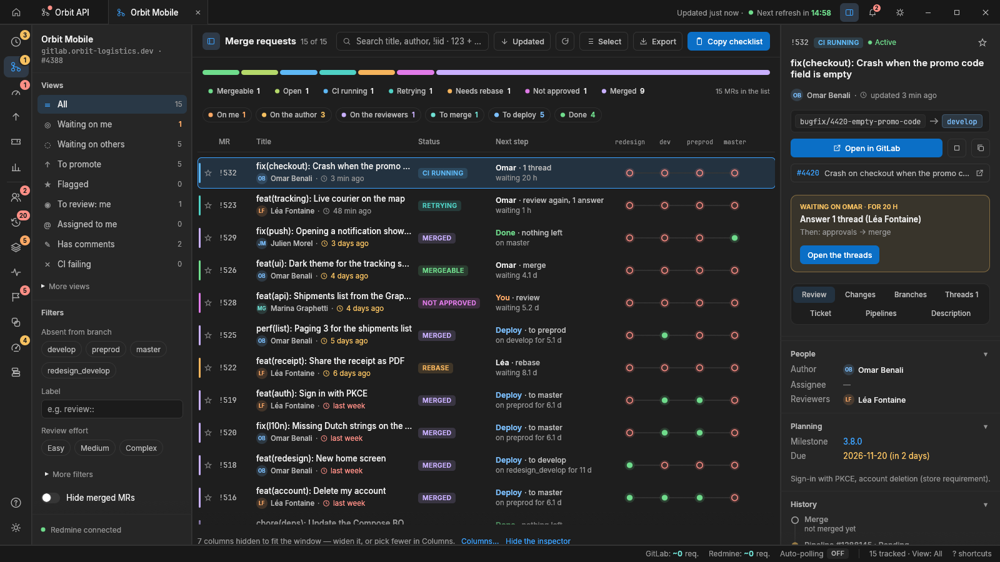

## MR page

A double click on a row (or `Enter`, or the inspector's ⤢ button) opens the MR
on a page of its own; `Esc` goes back, `J` / `K` move to the next or previous MR.

- **Tiles:** where it is (each tracked branch, and whether the environment
  deployed from it includes the MR), people, and the ticket (status, time spent
  against the estimate, Log time).
- **Why it can't merge:** conflicts, pipeline, threads, approval rules, commits
  behind (a click lists the merges and pushes on the target the MR lacks), draft,
  [unsigned commits](signed-commits.md).
- **Who could review** (open MRs): the people who know the files the MR
  changes — they changed, reviewed or approved them, or worked in their
  folders, in the MRs merged over the last 90 days — with their reviews
  waiting, and a button copying the `/assign_reviewer` quick action (the app
  only reads). Two people who together know more files than one alone are
  offered as a pair, and the files nobody but the author knows are listed.
- **Tabs:** the discussions in full (with the code each thread is about), the
  changes, the commits (where each one is, branch by branch) and the pipelines.
- **Pipelines, as a timeline:** each pipeline shows its jobs as stages, as in
  GitLab, or on a timeline (*Stages* / *Timeline*): each job where it ran, its
  wait for a runner before it, and the **critical path** lit — the chain of
  jobs that set the pipeline's duration. Under it, the path's jobs against
  their usual time (the median of their passed runs in the tracked MRs'
  pipelines), and what would give minutes back: each path job twice as fast,
  no wait for runners, and the longest job off the path, which gives nothing.
  The jobs' `needs:` are read over GraphQL; without it, the path follows the
  stage order, and the timeline says so.
- **Right column:** a timeline, approval rules, related MRs (same ticket, same
  branch, mentions) and how the MR compares with the other tracked ones.

Merge checks, approval rules (GitLab Premium; left out otherwise), threads and
deployments are read when the page opens, and again once the MR changes.

**Owners: `CODEOWNERS`, or deduced.** The project's `CODEOWNERS` (the first of
`CODEOWNERS`, `docs/CODEOWNERS`, `.gitlab/CODEOWNERS` on the MR's target
branch, matched as GitLab does: sections, default owners, `!` exclusions) is
applied whatever the GitLab tier — on Free GitLab enforces nothing, but the
file still says who answers for what. Each suggested person then says how the
file and the history agree: *Code owner* (declared, and knows the files),
*Code owner, not seen here* (declared, yet in none of the period's MRs on these
files: the file may be out of date), *Not in CODEOWNERS* (knows files the file
gives to others); a line sums it up per file. Without a `CODEOWNERS` (or when
the token may not read the repository's files), owners are **deduced** and
labelled so: in each folder, the one or two people who did the most (author
counted twice, reviewer or approver once, two merged MRs at least), looking up
to two folders higher when a folder has too few; the card gives the matching
`CODEOWNERS` lines to start one. The merged MRs are read once over GraphQL
(REST without it), kept on disk, and then only what merged since.

**Section bar.** When the page runs longer than the window, a bar under the
figures lists its sections: what blocks the merge, the description, the four
tabs (with their counts and the same dots), and, in a window too narrow for the
right column, that column's cards. A click scrolls there (a tab's also opens it)
and lights the section a moment; the bar shows the section in view. `[` / `]`
move to the previous or next section, `Home` goes back to the top. The figures
lead there too: a click on Pipeline, Threads, Approvals, Size or Effort scrolls
to its section. Delivery and CI / Pipelines have the same bar.

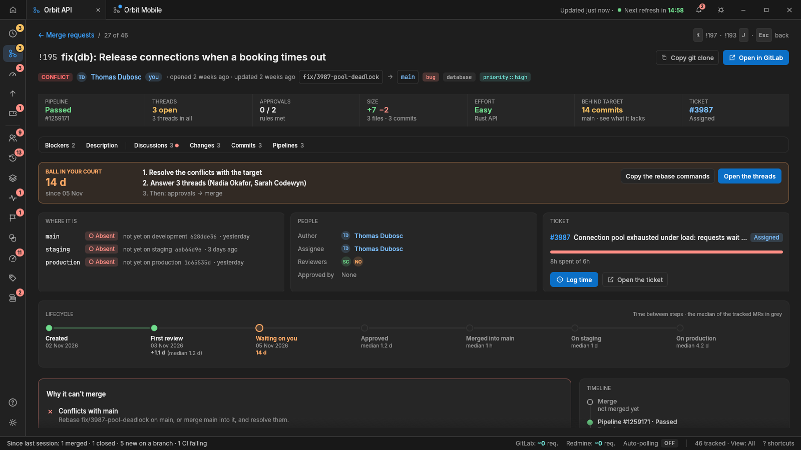

**Merge queue.** An MR on a merge train (GitLab Premium) shows the train on its
page: the target branch, then each car from the first, the MR picked out; where
each car's pipeline stands, and when it should be on the target. On GitLab Free,
or a project without trains, the MRs set to auto-merge make a **simulated**
queue, labelled as such: GitLab merges each one when its own pipeline passes,
so the order and the times are the app's estimate. The MRs ready to merge but
not set to are listed below it. The times come from the median of the tracked
MRs' passed pipelines over the last two weeks. While some MR is in a queue, the
table gets a **Queue** column: its place, `2/4` (blue on a train, gray when
simulated, red when stuck).
Its next step is then **GitLab's**, "Merging by itself": nobody has to act, so it
leaves "Ready to merge" on Today and the "Approved, not merged" stage; it goes
back to its author if it gets stuck.

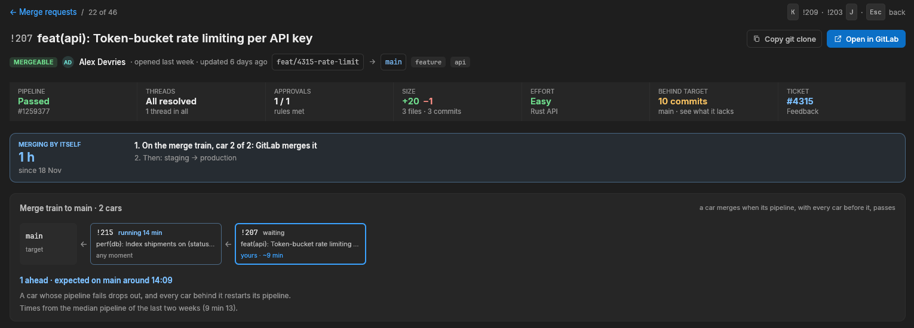

## Today

Across every open tab: the reviews waiting for you, your MRs that need you (CI
failed, conflicts, threads to answer, changes requested), those ready to merge,
those waiting on others, and what you merged today. A click shows the MR in its
tab. **Copy my stand-up** puts what you did since the last working day (merged,
reviewed, pushed, opened), what is on today and what waits on others in the
clipboard.

The moon button of a row **snoozes** the MR: in an hour, tomorrow at 09:00, next
Monday at 09:00, or until it changes. It leaves Today, the rail's badge and the
Cockpit's "Needs attention" until then, and comes back early on a push, a failed
pipeline, a new comment, or once merged or closed. The snoozed MRs wait folded at
the end of the page, with **Wake now**. The times are your computer's local time
(daylight saving included) and kept as an instant, so a snooze still wakes at the
right moment after a clock change or a trip; it is saved with the project's state,
and the terminal UI keeps it.

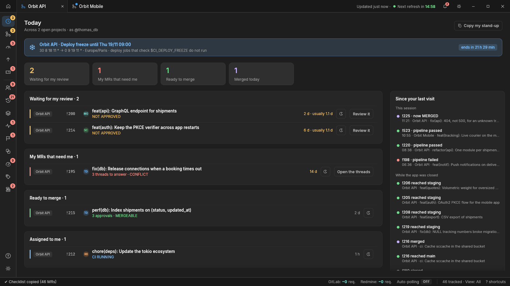

## Cockpit

Where MRs wait (review, author, approved but not merged, between branches) with
the bottleneck; the headline counters (blocked, to review, next release, oldest);
the attention, delivery, quality and release cards; four weekly trends (merges,
time to first review — from ready for review —, lead time to production, CI
success); then the MRs that need attention, most urgent first.
**Open MRs by label** gives, for each label, how many open MRs carry it, where
they wait (the next step, as the table's chips), their median age and the oldest;
sorted by count or by age. A click on a label lists its MRs in the table, a click
on the oldest opens it.

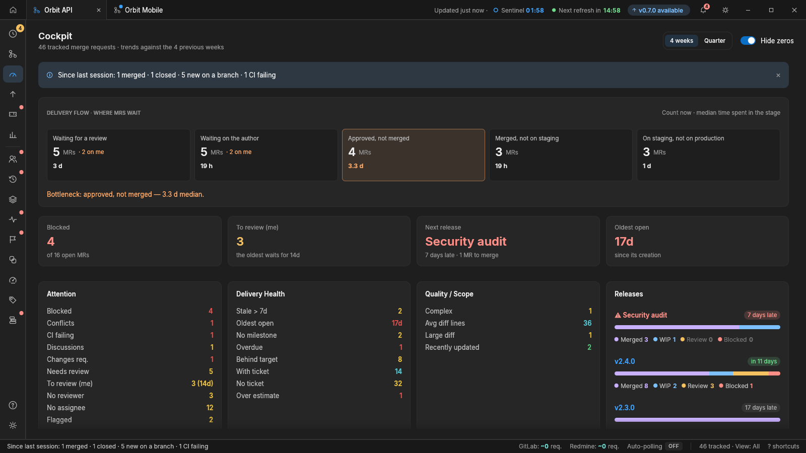

## Promote

Between two tracked branches (the last two by default, e.g.
`staging → production`): what is ready to go, what is not on the first branch yet
and what holds it back, and what already went. The ready list copies as a release
checklist or shows in the table.

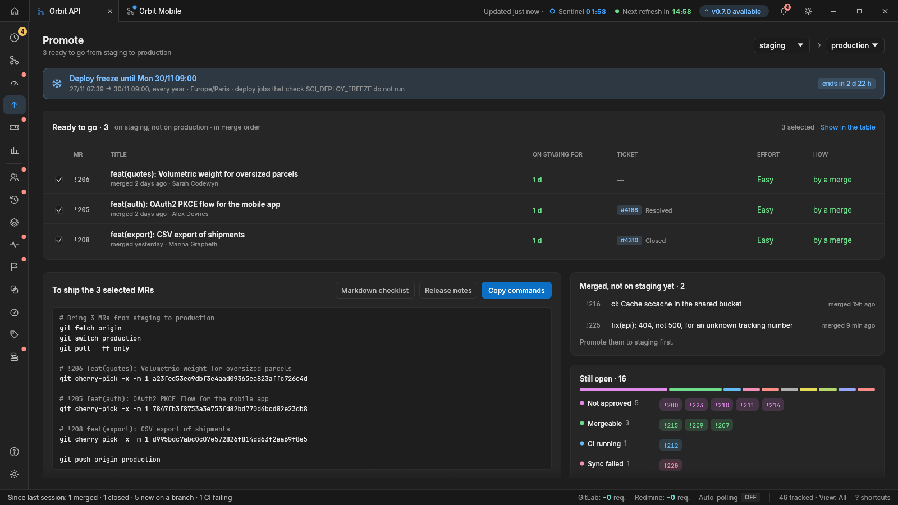

## Environments

The tracked branches from feature to production as cards: the environment
deployed from each, its last deployment, its branch's latest pipeline, and what
it has that the next branch lacks; every gap between two branches (fixes to bring
back upstream included), two weeks of deployments, and a way into Promote.

**Deploy freezes** are read from GitLab (Settings › CI/CD › Deploy freezes). A
project that declares none there can declare them in the app's settings (`,` ›
Delivery › Deploy freezes), in the same form: a start cron, `->`, an end cron and
a time zone, e.g. `0 18 * * 5 -> 0 7 * * 1 Europe/Paris`. GitLab's win when there
are some. Those of the app are a warning only: GitLab's set `$CI_DEPLOY_FREEZE`
in the pipelines, for the deploy jobs to check, the app's do not. While a freeze
holds, or starts within two days, a banner says until when on Promote,
Environments and Today. While it holds, the production card (the end of the flow)
turns blue, marked frozen, with its end, and the branch before it shows what
waits for the thaw. The Environments page shows the next two weeks, the
frozen hours in blue, and each period with when it comes next. The crons are read
in the period's own zone, daylight saving included; the times shown are your
computer's.

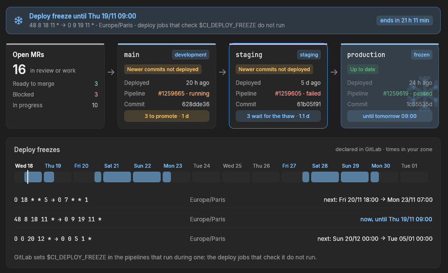

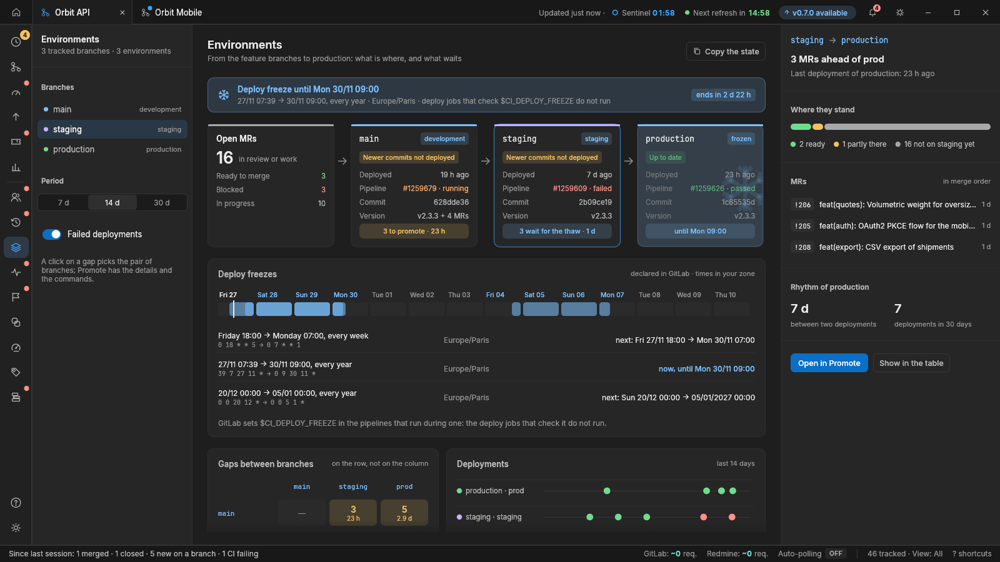

## Milestones

For each milestone: its MRs by where they stand (on production, on the way, to
merge, in review, back on their author, drafts) and whether it makes its due
date — a Monte Carlo forecast replaying the project's merges of the last eight
weeks 2,000 times: the chance to make the date and the 50 / 85 / 95 % dates. Plus
a burn-up, its tickets' time and its people. Copies as release notes.

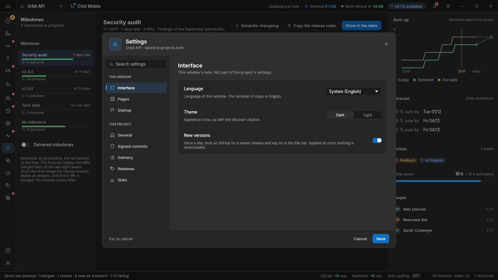

## Delivery

The four DORA measures (deployment frequency, lead time, change failure rate,
time to restore), each in its band from Elite to Low; where the time goes in each
merged MR's path; the review rounds; and the open MRs by step and age.

**Where the time goes** cuts each merged MR's path in five steps, coloured by
who has the MR: the team at work in cool hues (teal *In development*, blue *In
review*), the waits in warm ones (amber *Waiting for a review*, orange *Waiting
for the merge*), and purple after the merge (*Waiting for production*). The
development ends when the MR leaves draft, else at its first review request;
comments while a draft are the review along the way, not the first review nor
rounds. Under the steps: how many MRs were opened as drafts and reviewed along
the way, and, in amber, how many never were a draft (their development cannot
be told from their wait). See [the review timeline and
drafts](how-it-works.md#the-review-timeline-and-drafts).

**Reverts and hotfixes** lists what had to be undone or patched in the period:
each revert with the MR it undoes, how long after its merge, and how far that MR
had gone (in red when it reached production); each hotfix with a guess at what it
patches (the latest MR merged before it that changed the same files). A revert
finds its MR by the description GitLab's Revert button writes ("This reverts merge
request !12"), a reverted commit, or the quoted title. Hotfixes are the MRs
labelled hotfix or whose branch matches the project's **Hotfix branches** setting
(`hotfix/*` by default; see [configuration](configuration.md)). Those on
production in the period are the change failure rate's failures. The MR page
names the revert under **Related MRs**, both ways.

**Against the period before.** *Compare with* (on by default) sets each
figure against the period of the same length just before (the 30 days before
the last 30, say): under each DORA measure, ▲ or ▼ the way it went and from
what, in green when it is better, orange when worse, grey when either side has
fewer than five cases (too few to tell); in *Where the time goes*, a thin bar
under each step for the period before, with an arrow by the value; under the
review rounds, the share approved at the first round then. The period before
counts only what happened in it: an MR merged since is in the current one. It
reads the same data as the page, so a project tracked for less than two
periods has little to compare yet.

**Copy the weekly report** puts it all, with the CI and the milestones'
forecasts, in the clipboard as Markdown.

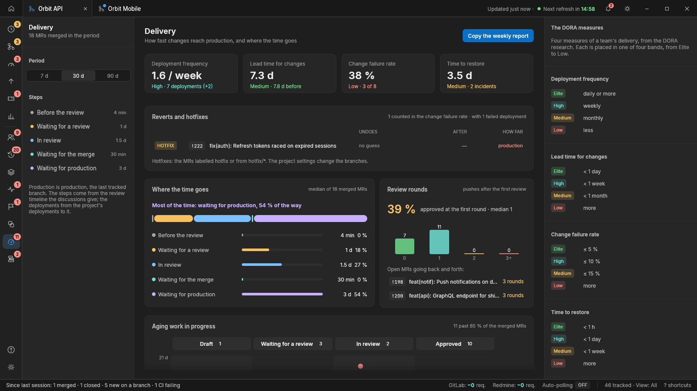

## Releases

What shipped, and what the next release will hold. The releases are the
project's GitLab releases, else its tags named like a version (`v1.2.0`,
`3.8.0`).

What a release holds is read from git, not guessed from dates: the commits
between it and the release before (`v2.3.2..v2.3.3`), each tied to its MR by its
merge commit (`See merge request !N`), its SHA, or its `cherry picked from`
trailer. MRs the app does not track are listed too, by the title in their merge
commit. **Unreleased** is the same range from the latest release to the
integration branch (`main`, `develop`…), each MR with the furthest tracked branch
it reached; a fix already picked into a release is not listed again.

The figures give the latest release and where it was deployed, how many MRs wait
and for how long (in amber when longer than twice the usual cadence), the median
time between releases over 90 days, and the **next version**: major for a
breaking change (`feat!:`, `BREAKING CHANGE`), minor for a feature, patch
otherwise, from the MR titles. **Draft release notes** groups the unreleased MRs
by kind, to copy as Markdown and paste in GitLab when you tag. With a ticket
tracker, the **Tickets in release notes** setting (per project) starts each line
with the MR's ticket, linked: `- [Feature #1234](…) - New checkout (!42)`.
**Generate
changelog** runs the project's git-cliff config instead, when it has one. Pick a
release, in the list or the history, to see what it holds, where it was deployed
and its notes in GitLab.

Reading the releases needs **Release › Read** on the token; without it the
version tags stand in (see [GitLab token](gitlab-token.md)).

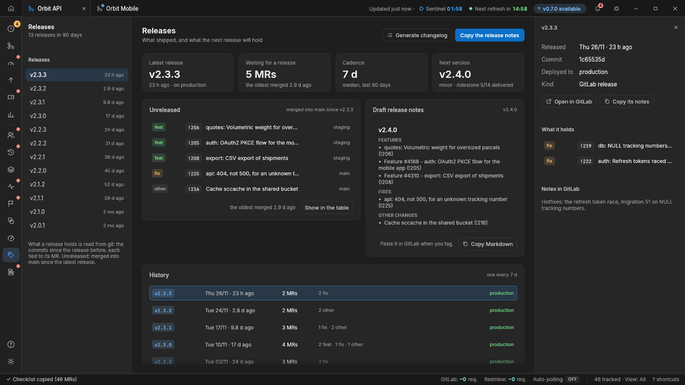

## CI / Pipelines

How often the tracked MRs' pipelines pass and how long they take, each job's last
20 runs with its failure rate and trend, the flaky jobs (a failure, then a pass on
the same commit), failures by stage, the MRs held back by the CI and the tracked
branches' latest pipeline. A **CI budget** adds up runner time, what failed
pipelines spent, the wait for a runner, and the costliest jobs.

**Pipeline schedules** (the nightly runs nobody watches) each show their cron in
words and as written, with its time zone; their last 14 runs as a strip, oldest
left (a click opens a run); when they run next; and their owner. A schedule that
fails two runs in a row or more gets a banner at the top of the page, with its
last green run. One that fails while the app is open lands in the bell. One
whose owner's account is blocked is flagged: GitLab no longer runs it.

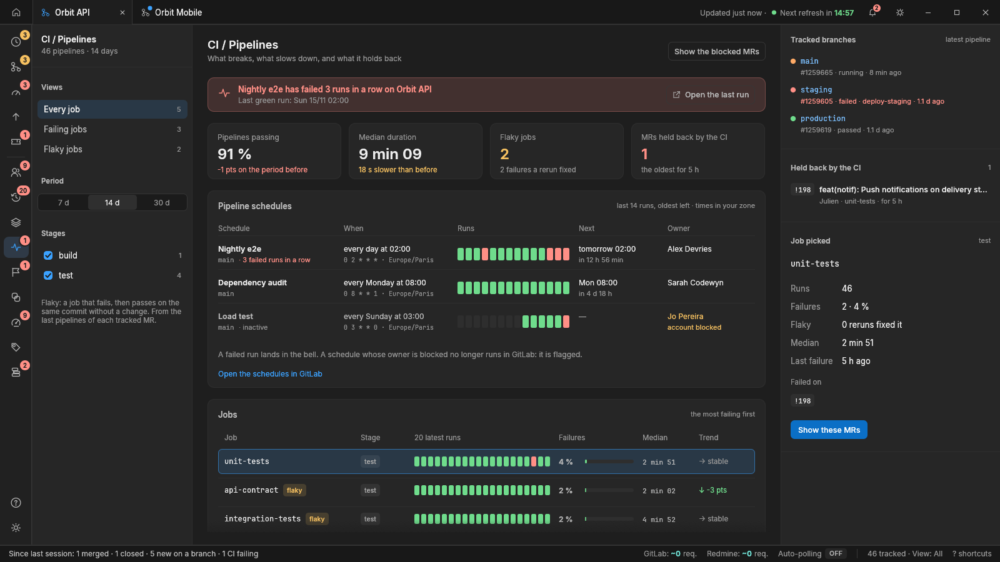

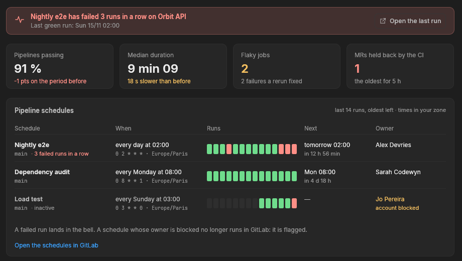

## Team

Per person: the reviews waiting on them (red past the review reminder delay),
their open MRs and what each waits on, the threads they have to answer, how fast
they answer a review request, and their load; who reviews whom over 7, 30 or 90
days. The summary and a reminder copy to paste in a chat.

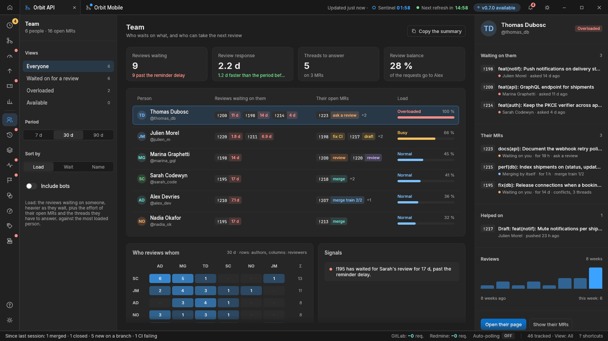

A double click on a person opens their page: twelve weeks of activity, who asks
them for reviews and whom they ask, where their MRs spend their time, and their
latest MRs. Their figures are compared with the team's median, never ranked.
`Esc` goes back, `J` / `K` move between people.

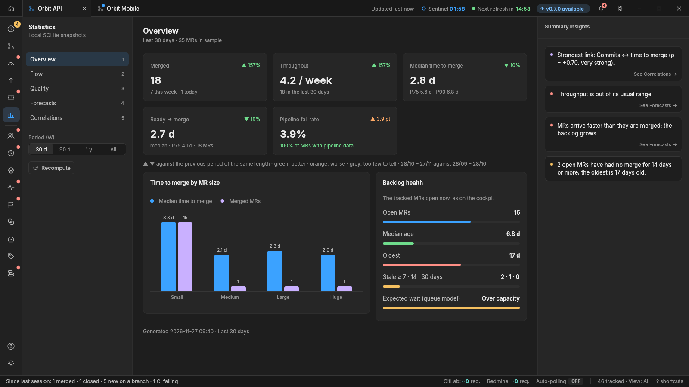

## Journal

What happened on the MRs of every open tab, newest first and by day: opened,
review asked, approved, threads, pipelines, merged, arrived on a branch (and
how). Rebuilt from what the MRs already carry, so it has a past from the first
launch; filters by type, tab, period, and "only what concerns me".

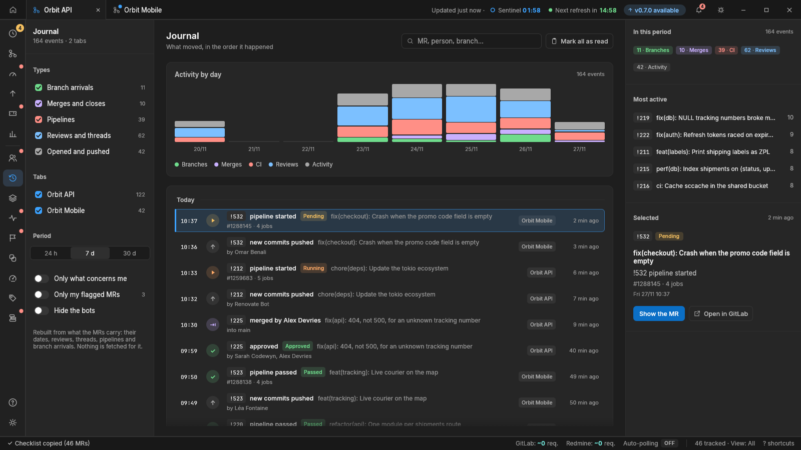

## Overlaps

The open MRs that change the same files, on the same lines, a few lines apart, or
only in the same file; a matrix of the pairs, the files changed by the most recent
MRs, and for the pair picked where the two meet and which one to merge first.

**Bottlenecks**, next to the hot spots, ranks the folders (or files) where the
stuck open MRs meet: a path scores one per open MR changing it that is in conflict,
failing its CI, or quiet for the project's stale days, among two MRs or more. A
click unfolds it: its MRs and why each is stuck, the last change merged to it, and
the order to merge them in — ready ones first, then in review, drafts and the stuck
ones, the smallest change first in each — even when some must be fixed first (it
then says so). A button lists them in the table.

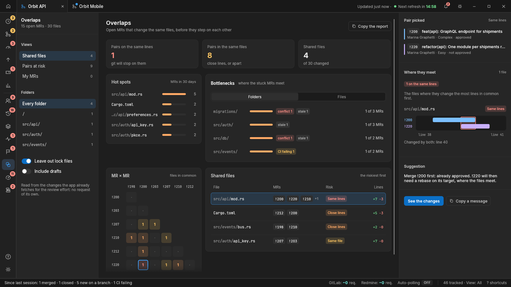

## Stacked MRs

The MRs opened on another MR's branch, as chains in merge order; flags a parent
merged while its child still targets its branch (retarget), a parent pushed to
after its child (rebase), a parent holding its children back, and a child ready
before its parent.

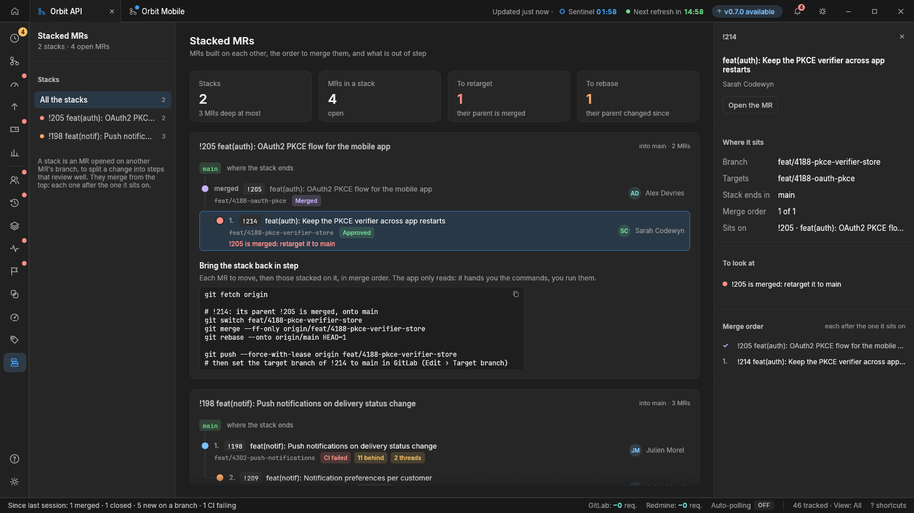

## Tracker

*With a tracker plugin such as Redmine.* The tickets linked to the tracked MRs,
by status, with their time spent against the estimate; the MRs without a ticket
and the tickets over their estimate.

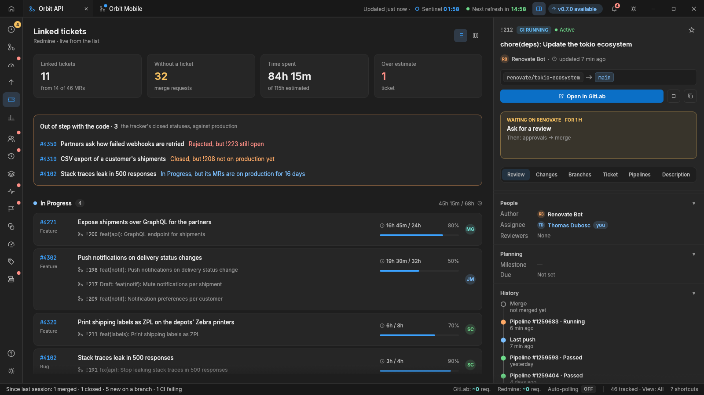

## Stats

*With `--features stats`.* Throughput, time to merge (by MR size too), pipeline
failure rate, backlog health and insights, then flow, quality, forecasts and
correlations, from the local stats database (see
[Analytics and velocity stats](terminal.md#analytics-and-velocity-stats)).

Two times to merge sit side by side: **Median time to merge**, from the opening
(the whole cycle, development included), and **Ready → merge**, from the move
out of draft (else the first review request): the time to merge without the
development, for MRs opened as drafts when the work starts.

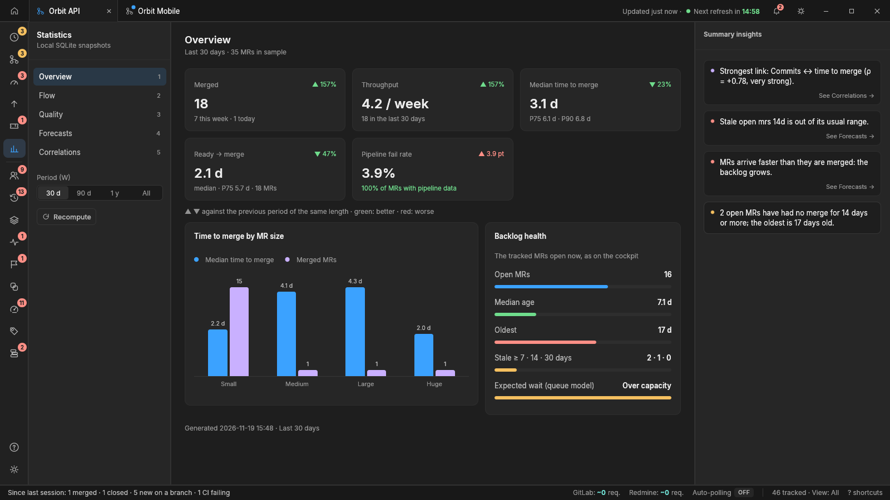

## Settings and columns

**Settings** (`,`, or the gear at the bottom of the rail) has a tab per section
on the left: the window's own (language, theme) first, then the project's
(general, signed commits, delivery, releases, stats). The search above the tabs
goes through every section's names and help at once, each tab counting what it
found. A dot marks what changed and is not saved yet, on the row and on its tab,
and the footer counts it; Save writes the project's to `projects.toml`, Cancel
or Esc leaves them as they were. Options that depend on another are greyed out
while it is off.

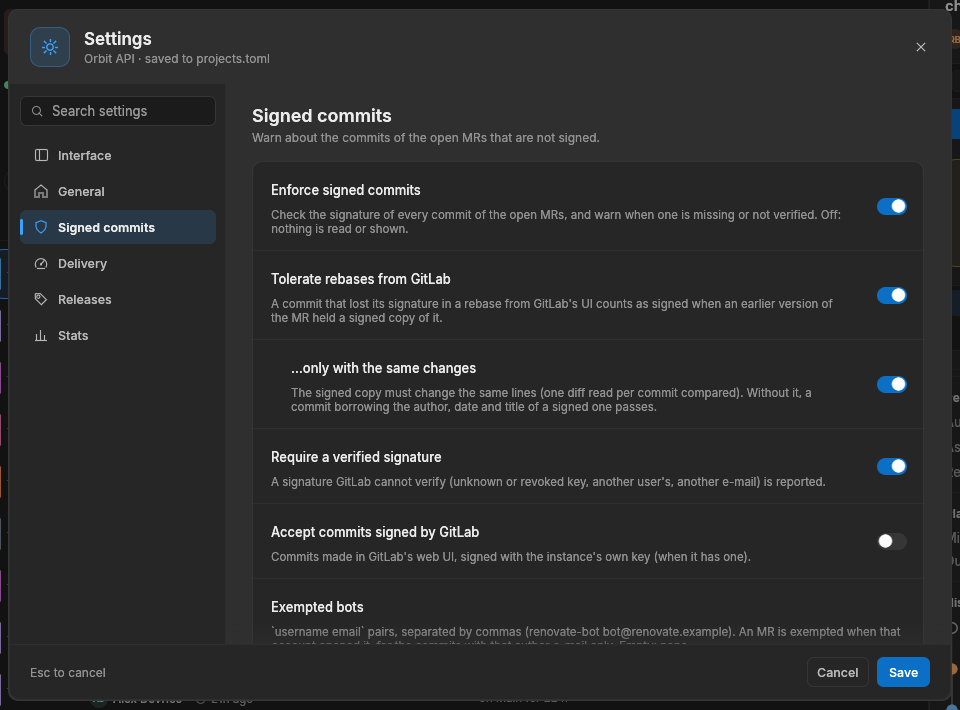

**Columns** (`C`, or *Columns…* in the table) previews the table's head as it is
drawn now: the columns picked in the accent, those the window has no room for
dashed. Below, a card per column to switch on or off: first those shared with
the terminal UI, then the window's own (next step, branches in one cell). The
changes apply at once and are kept for the project.

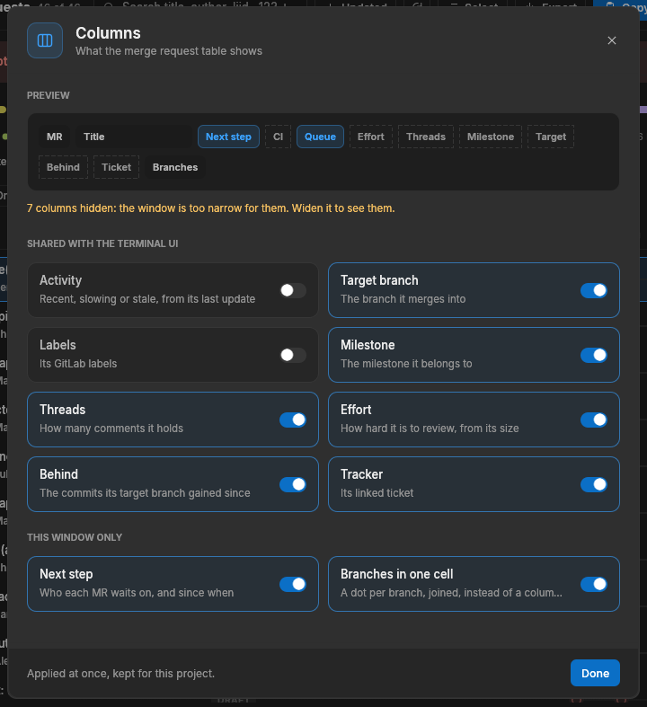

## Dock icon and launcher (Linux)

GNOME (Ubuntu) and KDE take the icon of a running window from a desktop entry
named after its app id (`gitlab-tracker`). Install it once for the current user:

```bash
sh assets/linux/install-desktop-entry.sh
```

This copies the icon into `~/.local/share/icons/hicolor/` and a
`gitlab-tracker.desktop` launcher into `~/.local/share/applications/`. Then start
*GitLab Tracker* from the applications menu and pin it to the dock.

The icon is generated by `assets/icon/make_icons.py` (Pillow) in every format:
SVG and PNG (Linux, window icon), `.ico` (Windows) and `.icns` (macOS).
