# Desktop window

`gitlab-tracker gui` opens the dashboard in a native window. It runs the same
state, actions and refresh cycle as the [terminal UI](terminal.md) and reads the
same `projects.toml`, state files and keyring, so both can be used on the same
projects.

- [Install and run](#install-and-run)
- [Projects in tabs](#projects-in-tabs)
- [Merge requests](#merge-requests)
- [MR page](#mr-page)
- [Today](#today)
- [Cockpit](#cockpit)
- [Promote](#promote)
- [Environments](#environments)
- [Milestones](#milestones)
- [Delivery](#delivery)
- [CI / Pipelines](#ci--pipelines)
- [Team](#team)
- [Journal](#journal)
- [Overlaps](#overlaps)
- [Stacked MRs](#stacked-mrs)
- [Tracker](#tracker)
- [Stats](#stats)
- [Dock icon and launcher (Linux)](#dock-icon-and-launcher-linux)

## Install and run

The window is behind the `gui` feature and is **not on crates.io yet**: it
depends on the `bevel` UI crates, which are not released. To build it from
source:

- Rust **1.95+** (required by `bevel`);
- the `bevel` repository checked out **next to** this one (`../bevel`, a path
  dependency for now);
- on Linux, the usual windowing libraries (Wayland and/or X11, OpenGL) — present
  on any desktop install.

```bash
cargo install --path gitlab-tracker --features gui      # add stats,redmine as needed

gitlab-tracker gui            # the active project
gitlab-tracker --demo gui     # demo data, read-only
```

On Linux the window draws its own title bar and buttons, laid out as the desktop
sets them (`GITLAB_TRACKER_TITLEBAR=system` keeps the desktop's frame). The
window never prompts in the terminal: with no project configured it opens a
setup window, and a project whose token is not in the OS keyring (or
`GITLAB_TOKEN` / `REDMINE_TOKEN`) asks for it in the window, then saves it to
the keyring. Which token to create: [GitLab token](gitlab-token.md).

## Projects in tabs

Each project opens in its own title-bar tab and keeps refreshing while hidden
(notifications, state saves and automatic tracker transitions go on); a dot on a
hidden tab says something changed, red when a fetch failed.

`+` (or `W`) lists the projects of `projects.toml` and offers **New project…**:
GitLab URL, project (id or path), optional name and branches, the token and,
with Redmine, the tracker's URL and API key. A token already saved for the same
instance needs not be typed again. Everything is checked against GitLab and
Redmine before it is saved; an empty name or branch list takes GitLab's name and
default branch, and your username is read from the token. The open tabs come
back at the next launch.

Keys: `Ctrl+Tab` / `Ctrl+Shift+Tab`, `Ctrl+1…9`, `Ctrl+W` (or a middle click)
closes a tab.

## Merge requests

The tracked MRs, with their state, review, pipeline and presence on every
tracked branch (see [branch presence](terminal.md#branch-presence)), views in
the sidebar and an inspector on the right. The inspector also reads, on demand,
the MR's changed files with their patches (**Changes**) and, for a failed job,
the end of its log (**Log**, in Pipelines). A click on a desktop notification
brings the window forward on that MR, in its tab.

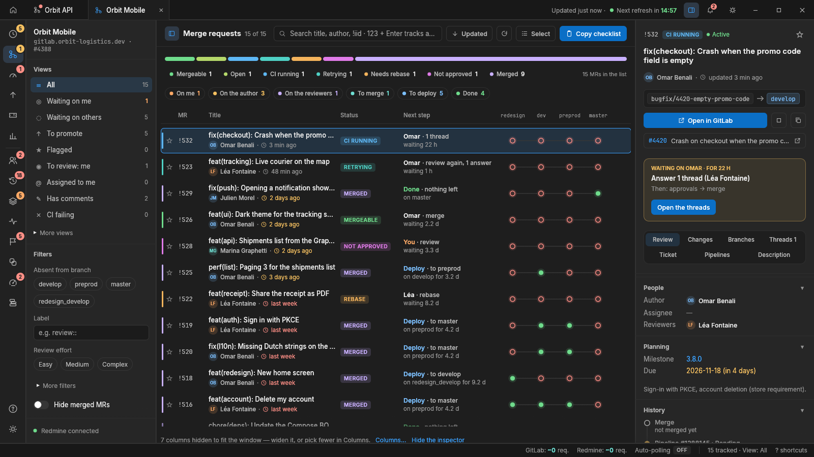

## MR page

A double click on a row (or `Enter`, or the inspector's ⤢ button) opens the MR
on a page of its own; `Esc` goes back, `J` / `K` move to the next or previous MR.

- **Tiles:** where it is (each tracked branch, and whether the environment
  deployed from it includes the MR), people, and the ticket (status, time spent
  against the estimate, Log time).
- **Why it can't merge:** conflicts, pipeline, threads, approval rules, commits
  behind (a click lists the merges and pushes on the target the MR lacks), draft,
  [unsigned commits](signed-commits.md).
- **Tabs:** the discussions in full (with the code each thread is about), the
  changes, the commits (where each one is, branch by branch) and the pipelines.
- **Right column:** a timeline, approval rules, related MRs (same ticket, same
  branch, mentions) and how the MR compares with the other tracked ones.

Merge checks, approval rules (GitLab Premium; left out otherwise), threads and
deployments are read when the page opens, and again once the MR changes.

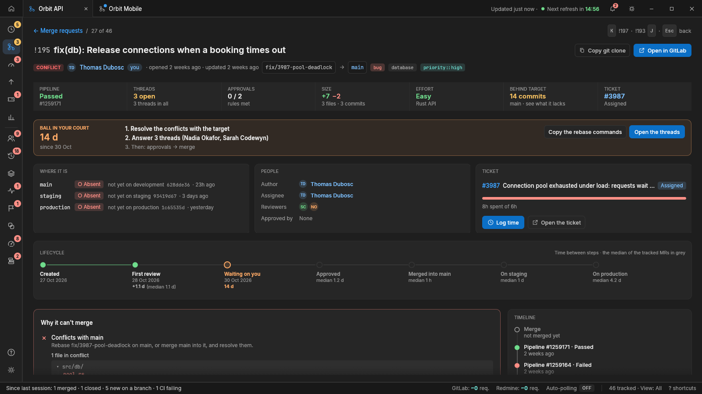

## Today

Across every open tab: the reviews waiting for you, your MRs that need you (CI
failed, conflicts, threads to answer, changes requested), those ready to merge,
those waiting on others, and what you merged today. A click shows the MR in its
tab. **Copy my stand-up** puts what you did since the last working day (merged,
reviewed, pushed, opened), what is on today and what waits on others in the
clipboard.

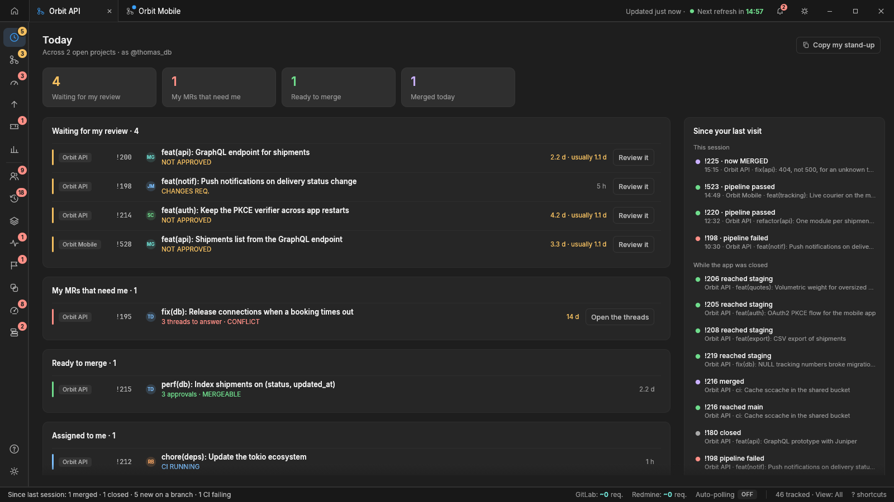

## Cockpit

Where MRs wait (review, author, approved but not merged, between branches) with
the bottleneck, four weekly trends (merges, time to first review, lead time to
production, CI success), and the MRs that need attention, most urgent first.

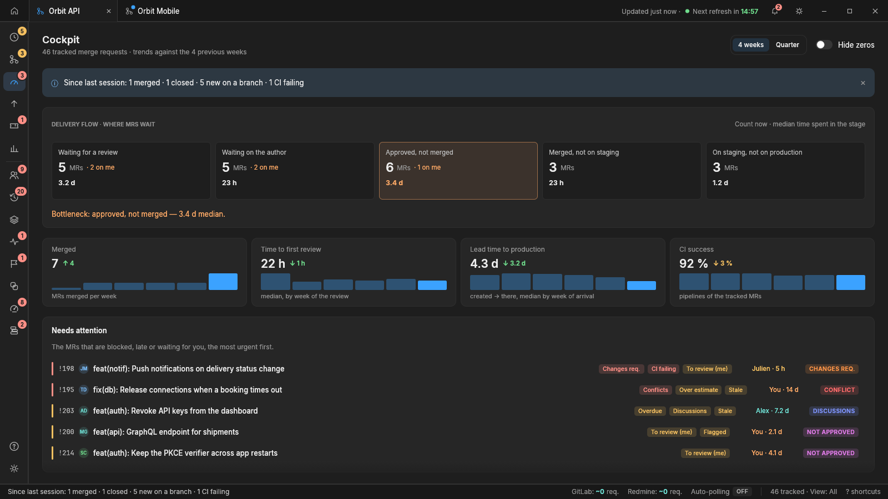

## Promote

Between two tracked branches (the last two by default, e.g.
`staging → production`): what is ready to go, what is not on the first branch yet
and what holds it back, and what already went. The ready list copies as a release
checklist or shows in the table.

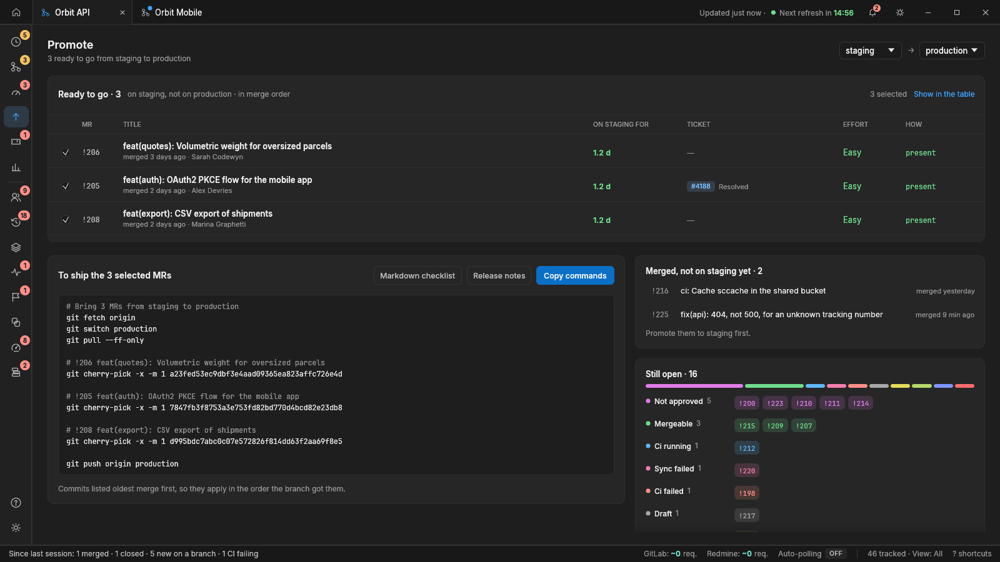

## Environments

The tracked branches from feature to production as cards: the environment
deployed from each, its last deployment, its branch's latest pipeline, and what
it has that the next branch lacks; every gap between two branches (fixes to bring
back upstream included), two weeks of deployments, and a way into Promote.

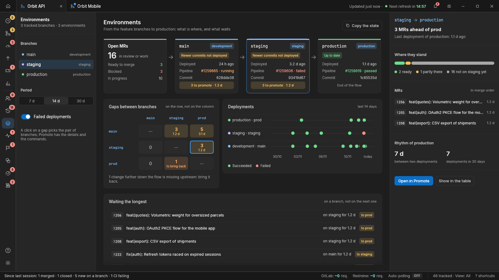

## Milestones

For each milestone: its MRs by where they stand (on production, on the way, to
merge, in review, back on their author, drafts) and whether it makes its due
date — a Monte Carlo forecast replaying the project's merges of the last eight
weeks 2,000 times: the chance to make the date and the 50 / 85 / 95 % dates. Plus
a burn-up, its tickets' time and its people. Copies as release notes.

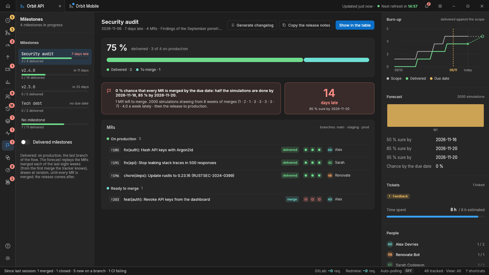

## Delivery

The four DORA measures (deployment frequency, lead time, change failure rate,
time to restore), each in its band from Elite to Low; where the time goes in each
merged MR's path; the review rounds; and the open MRs by step and age.
**Copy the weekly report** puts it all, with the CI and the milestones'
forecasts, in the clipboard as Markdown.

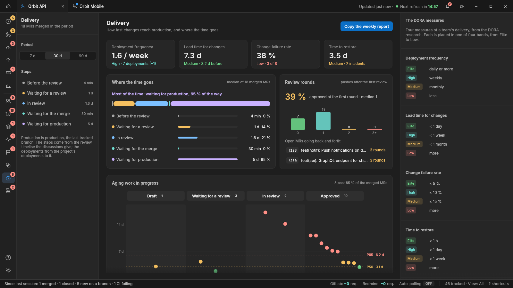

## CI / Pipelines

How often the tracked MRs' pipelines pass and how long they take, each job's last
20 runs with its failure rate and trend, the flaky jobs (a failure, then a pass on
the same commit), failures by stage, the MRs held back by the CI and the tracked
branches' latest pipeline. A **CI budget** adds up runner time, what failed
pipelines spent, the wait for a runner, and the costliest jobs.

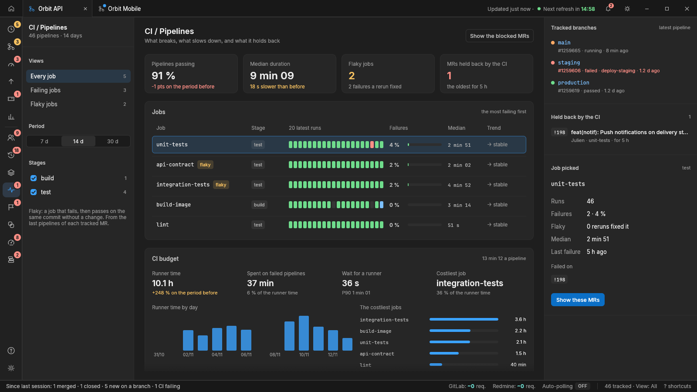

## Team

Per person: the reviews waiting on them (red past the review reminder delay),
their open MRs and what each waits on, the threads they have to answer, how fast
they answer a review request, and their load; who reviews whom over 7, 30 or 90
days. The summary and a reminder copy to paste in a chat.

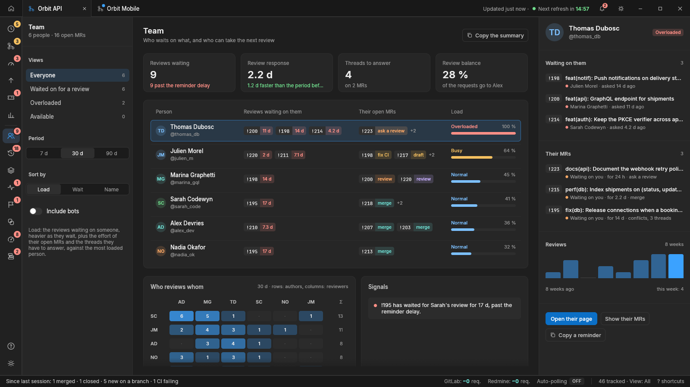

A double click on a person opens their page: twelve weeks of activity, who asks
them for reviews and whom they ask, where their MRs spend their time, and their
latest MRs. Their figures are compared with the team's median, never ranked.
`Esc` goes back, `J` / `K` move between people.

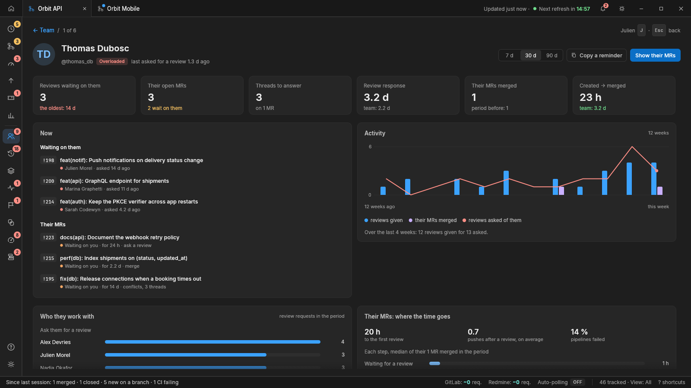

## Journal

What happened on the MRs of every open tab, newest first and by day: opened,
review asked, approved, threads, pipelines, merged, arrived on a branch (and
how). Rebuilt from what the MRs already carry, so it has a past from the first
launch; filters by type, tab, period, and "only what concerns me".

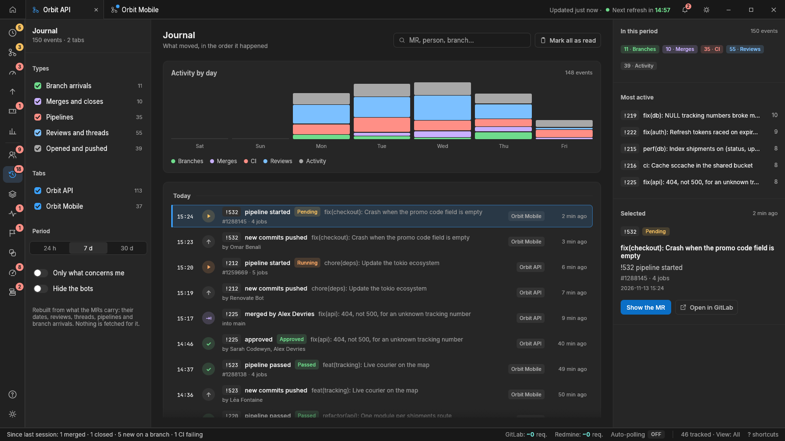

## Overlaps

The open MRs that change the same files, on the same lines, a few lines apart, or
only in the same file; a matrix of the pairs, the files changed by the most recent
MRs, and for the pair picked where the two meet and which one to merge first.

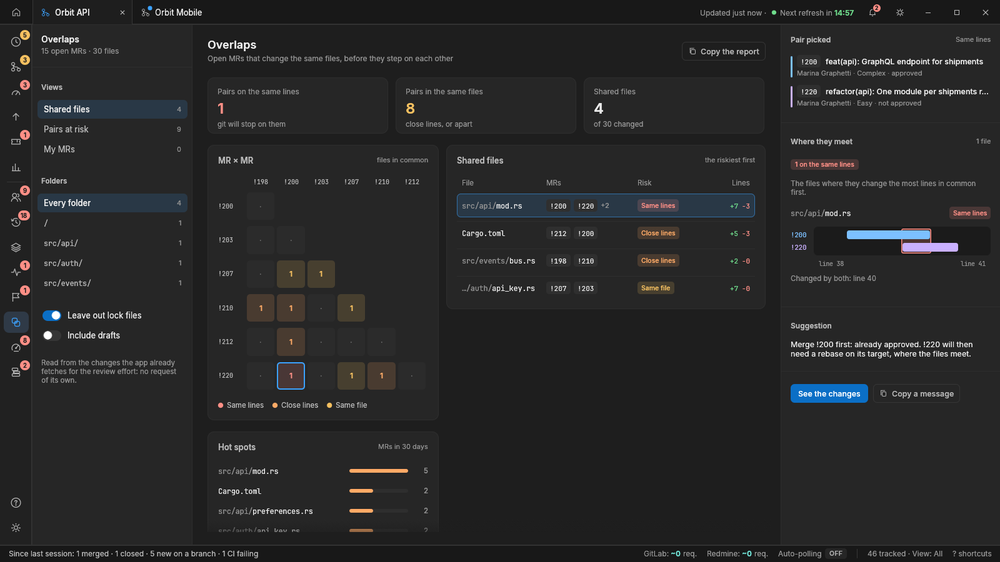

## Stacked MRs

The MRs opened on another MR's branch, as chains in merge order; flags a parent
merged while its child still targets its branch (retarget), a parent pushed to
after its child (rebase), a parent holding its children back, and a child ready
before its parent.

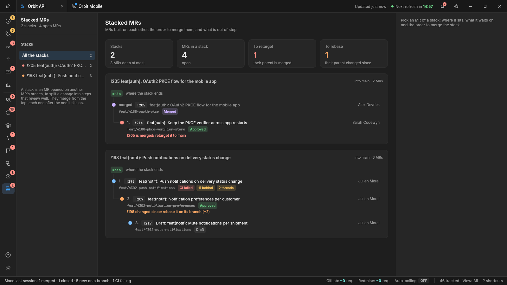

## Tracker

*With a tracker plugin such as Redmine.* The tickets linked to the tracked MRs,
by status, with their time spent against the estimate; the MRs without a ticket
and the tickets over their estimate.

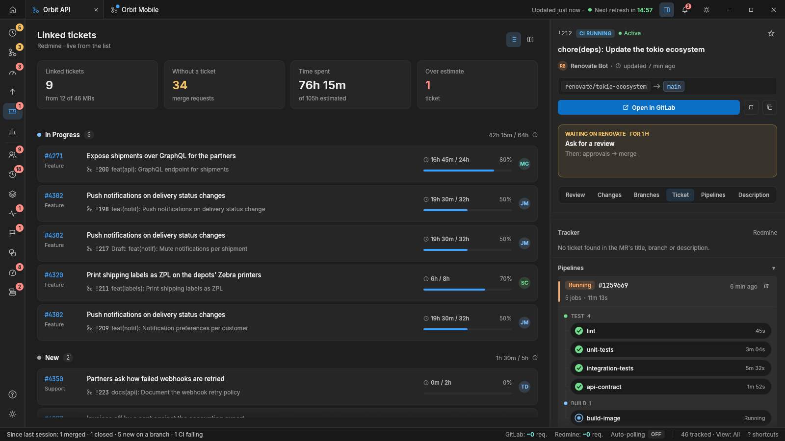

## Stats

*With `--features stats`.* Throughput, time to merge (by MR size too), pipeline
failure rate, backlog health and insights, then flow, quality, forecasts and
correlations, from the local stats database (see
[Analytics and velocity stats](terminal.md#analytics-and-velocity-stats)).

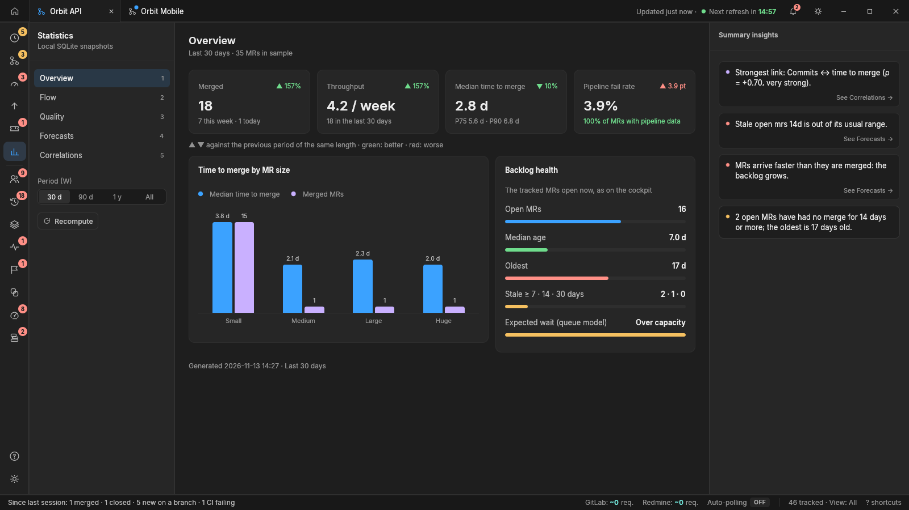

## Dock icon and launcher (Linux)

GNOME (Ubuntu) and KDE take the icon of a running window from a desktop entry
named after its app id (`gitlab-tracker`). Install it once for the current user:

```bash
sh assets/linux/install-desktop-entry.sh
```

This copies the icon into `~/.local/share/icons/hicolor/` and a
`gitlab-tracker.desktop` launcher into `~/.local/share/applications/`. Then start
*GitLab Tracker* from the applications menu and pin it to the dock.

The icon is generated by `assets/icon/make_icons.py` (Pillow) in every format:
SVG and PNG (Linux, window icon), `.ico` (Windows) and `.icns` (macOS).
