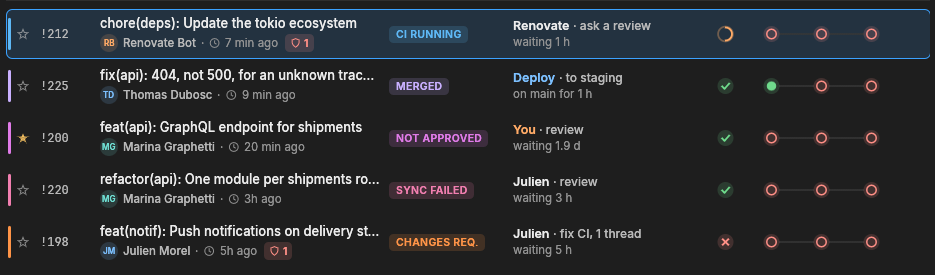
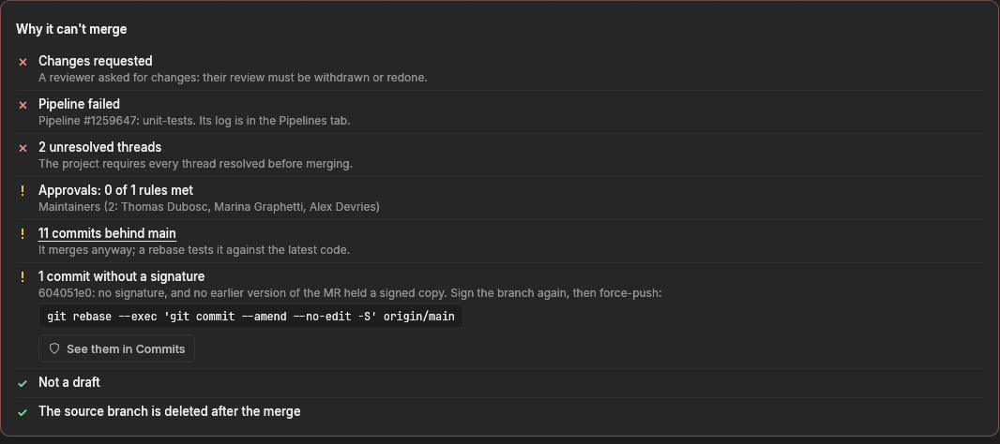
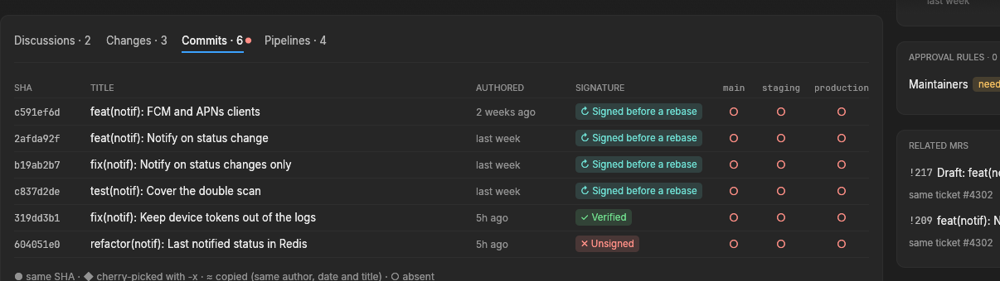
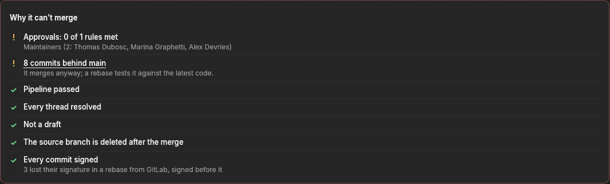

# Signed commits

Projects that require every commit to be signed can ask the tracker to check
the signature of each commit of their open merge requests, and to warn when one
is missing or cannot be verified. The check is **off by default**: until it is
turned on, nothing is read from GitLab and nothing is shown.

It **warns, it never blocks**: whether an MR with an unsigned commit may still
be merged is the team's call (usually the tech lead's).

- [What it shows](#what-it-shows)
- [Rebases done from GitLab's UI](#rebases-done-from-gitlabs-ui)
- [Configuration](#configuration)
- [What each commit can be](#what-each-commit-can-be)
- [What it costs in API calls](#what-it-costs-in-api-calls)
- [Fixing an MR](#fixing-an-mr)
- [Limits](#limits)

## What it shows

Nothing changes on an MR whose commits are all signed. When one is not:

**The MR list** puts a shield next to the author, with the number of commits
at fault (red: unsigned, amber: signed but not verified). Hovering it tells
which.



**The MR page**, in *Why it can't merge*, adds one warning line per kind of
problem: the commits at fault, the command that signs the branch again, and a
button to the Commits tab.



**The Commits tab** gets a *Signature* column, and a dot on its title. Each
commit's tooltip says why it is what it is; for a commit rebased by GitLab, it
names the signed copy it was matched with.



The window's Inspector shows a *Signatures* row, and the terminal UI's
Inspector a `Signed` line, only when something is off.

## Rebases done from GitLab's UI

GitLab's *Rebase* button rewrites every commit of the MR. On most instances it
does not sign them (on some, it signs them with the instance's own key): the
author's signature is gone, even though they signed every commit they pushed.

The tracker does not take those for unsigned commits. GitLab keeps every
version of an MR (each push, each rebase), and the commits of the earlier
versions stay readable, signatures included. A commit that has no signature (or
only the instance's) is taken as **signed before a rebase** when:

1. the version that brought it in has **the shape of a rebase**: its base moved,
   and it added no commit (one may drop, when it was already upstream);
2. the version just before it holds a **copy** of it: same author e-mail, same
   author date, same title (a rebase keeps all three);
3. the copy has **the same changes**: same files, same lines added and removed
   (line numbers and the context around them may move);
4. the copy's own signature is accepted, or it was itself rebased from a signed
   one (an MR rebased twice is traced back to the first signature).



Point 3 is what keeps this tolerance from being a way around the rule: anyone
can write the author, date and title of a signed commit into a new one, but not
make it change the same lines and something else. It can be turned off
(`require_same_patch = false`) to save one diff read per commit compared, at
that price.

A commit pushed after the rebase must be signed like any other: only the
commits the rebase rewrote are traced.

## Configuration

In the window: **Settings** (`,`) → **Signed commits**, saved to
`projects.toml`. Or by hand, per project:

```toml
[[project]]
name = "My Company — Backend"
gitlab_url = "https://gitlab.my-company.com"
project_id = "12345678"

[project.signed_commits]
# Check every commit of the open MRs. Default: false.
enforce = true
# A signature lost in a rebase from GitLab's UI is forgiven when an earlier
# version of the MR held a signed copy of the commit. Default: true.
tolerate_gitlab_rebase = true
# ...only when the copy changes the same lines. Default: true.
require_same_patch = true
# A signature GitLab cannot verify (unknown or revoked key, another user's,
# another e-mail) is reported. Default: true.
require_verified = true
# Commits signed with the instance's own key (made in GitLab's web UI) are
# accepted. Default: false.
accept_system_signed = false
# Bots whose commits need no signature: `username email` pairs, separated by
# commas. Default: none.
exempt_bots = "renovate-bot bot@renovate.example"
```

Turning `enforce` off keeps the other options, for the next time it is on.

### Exempting a bot

A bot such as Renovate or Dependabot commits on its own, and usually without a
key on a self-managed instance. Two ways to keep its MRs quiet:

- **Give it a key** (preferred): Renovate signs its commits with GPG when given
  one (`gitPrivateKey`); add the public key to the bot's GitLab account and its
  commits show as verified. No exemption needed.
- **Exempt it**: list its GitLab username **and** the e-mail its commits are
  authored with. A commit is exempted only when **both** match: the MR was
  opened by that account (which nobody else can do), and the commit names that
  author e-mail (which anybody can write in a commit, so it never exempts
  anything alone). A commit a human adds to the bot's MR is still checked.

## What each commit can be

| Shown | Meaning | Accepted |
| :--- | :--- | :--- |
| `✓ Verified` | Signed, and GitLab verified the signature. | yes |
| `↻ Signed before a rebase` | Lost its signature in a rebase from GitLab; a signed copy was found (see above). | yes |
| `✓ Signed by GitLab` | Signed with the instance's key, not its author's. | with `accept_system_signed` |
| `! Not verified` | Signed, but GitLab cannot verify it: unknown, revoked or unverified key, another user's key, an e-mail that is not the key owner's, several signatures. | without `require_verified` |
| `✕ Unsigned` | No signature, and no signed copy in an earlier version. | no |
| `– Exempted bot` | From a bot listed in `exempt_bots`. | yes |
| `… Checking` | Not read yet (the next refresh reads it). | — |

A not verified signature is never forgiven as a rebase: GitLab does not sign
with someone else's key, so that one is the author's to fix (most often: add
the public key to their GitLab profile, or sign with the e-mail of their
GitLab account).

## What it costs in API calls

Signatures are read after each refresh, for the **open** MRs only, and kept
with the MR (in the state file): a commit's signature never changes, so each is
read once.

| When | Calls |
| :--- | :--- |
| Every commit signed | One per commit (`/repository/commits/:sha/signature`), once. |
| A commit without a signature | Plus the MR's versions (`/merge_requests/:iid/versions`, at most the 20 newest) and the commits of each (`/repository/commits?ref_name=base..head`, no diffs). |
| A copy found | Plus its signature, and the diff of both commits (`/repository/commits/:sha/diff`), unless `require_same_patch = false`. |

Nothing is read when the check is off. What could not be read (GitLab down, a
timeout) is read again at the next refresh.

## Fixing an MR

The warning gives the command; on the MR's branch:

```sh
git rebase --exec 'git commit --amend --no-edit -S' origin/main
git push --force-with-lease
```

This signs every commit of the branch again (with the key of whoever runs it).

## Limits

- **A diff GitLab leaves out** (too large, or collapsed) has no patch to
  compare: a copy of such a commit is not matched, and the commit stays
  reported.
- **Versions further back than the 20 newest** are not read: a rebase that
  happened before that cannot be traced.
- **MRs that are merged or closed** are not checked.
- **The window and the terminal UI** show the warning; desktop notifications
  and the MR list's filters do not know about signatures yet.
