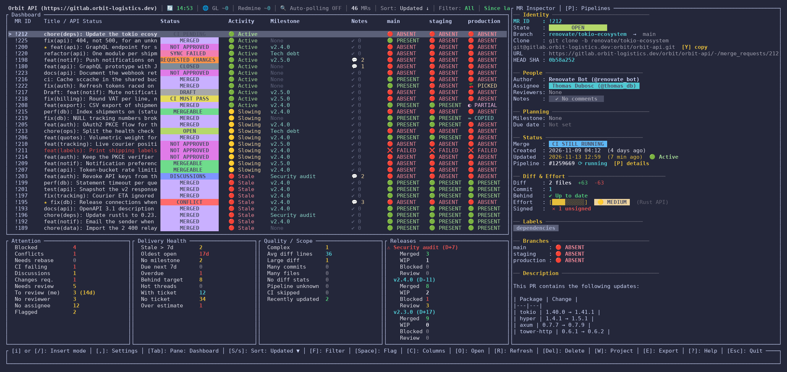
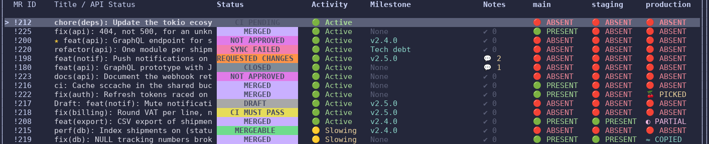
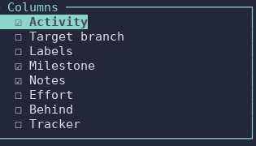
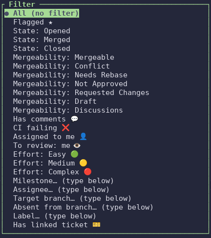
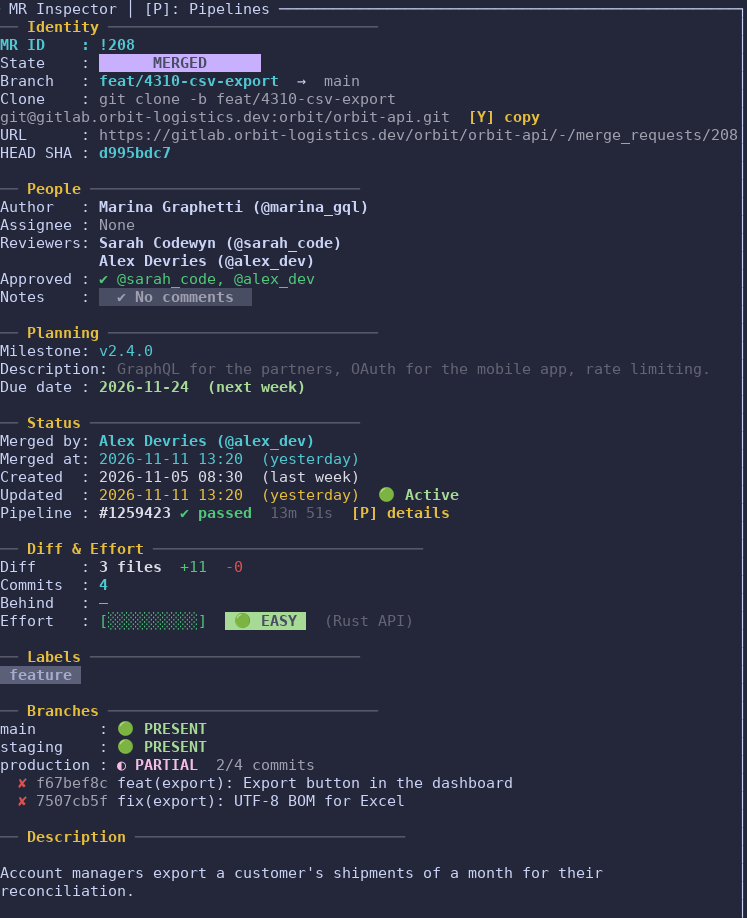
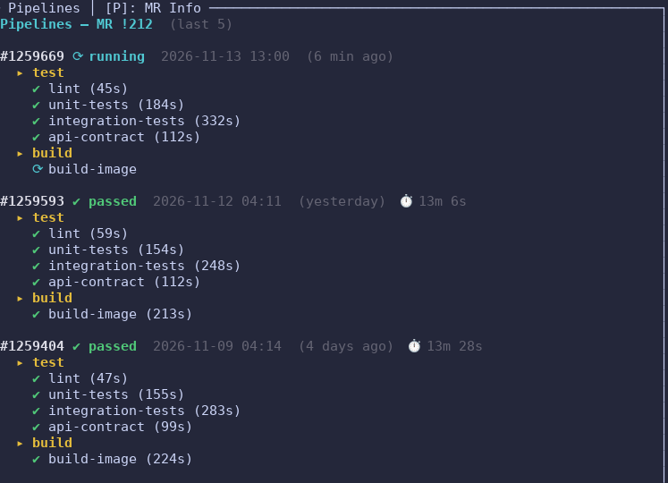
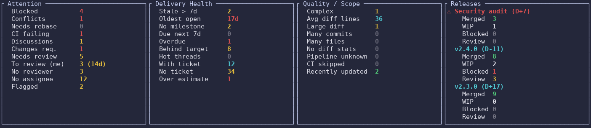
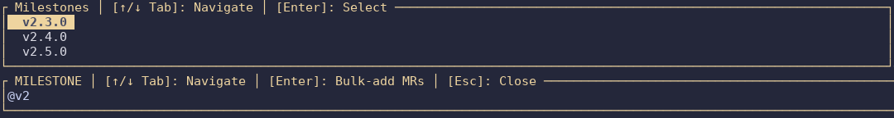
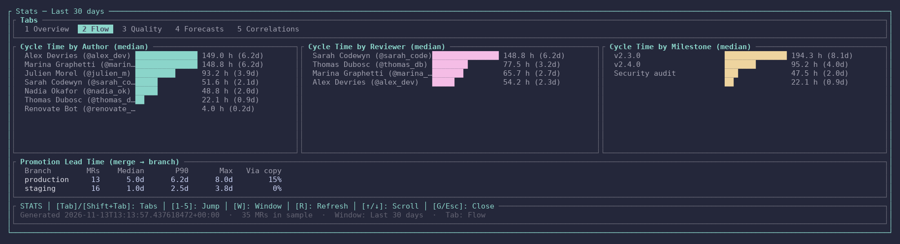
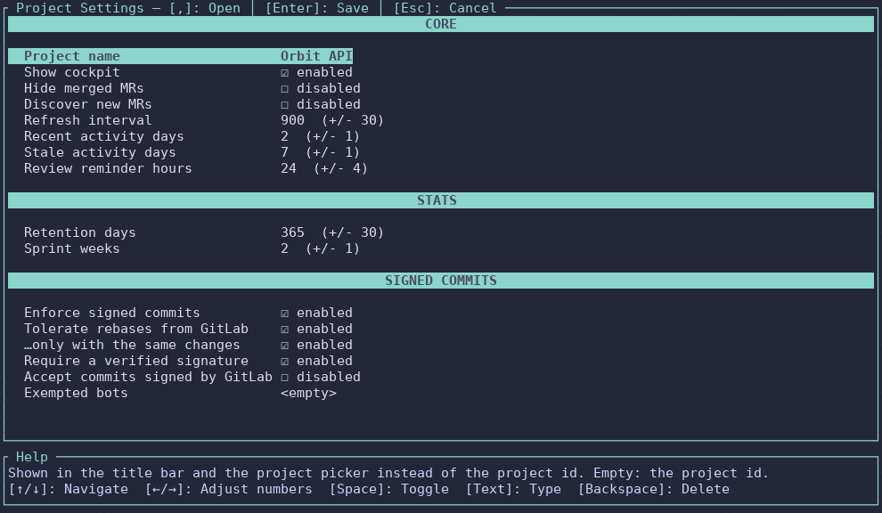

# Terminal UI

`gitlab-tracker` (no subcommand) runs the dashboard in the terminal, driven from
the keyboard — for those who live in a terminal or work over SSH. It shares the
[desktop window](desktop-window.md)'s state, refresh cycle, `projects.toml` and
keyring. Installation, the first run and the configuration are in the
[main README](https://github.com/julien-langlois/gitlab-tracker/blob/main/README.md).

- [Branch presence](#branch-presence)
- [MR table](#mr-table)
- [Flags and filters](#flags-and-filters)
- [Inspector](#inspector)
- [Cockpit](#cockpit)
- [Release workflow](#release-workflow)
- [Notifications](#notifications)
- [Analytics and velocity stats](#analytics-and-velocity-stats)
- [Signed commits](#signed-commits)
- [Desktop window](#desktop-window)
- [Under the hood](#under-the-hood)
- [Keyboard shortcuts](#keyboard-shortcuts)



## Branch presence

Each branch cell tells how an MR reached that branch — whatever the promotion
workflow (merge, `reset --hard`, cherry-pick from the CLI, GitLab or SmartGit,
rebase, commit by commit). See [How Branch Presence Is Detected](https://github.com/julien-langlois/gitlab-tracker/blob/main/README.md#-how-branch-presence-is-detected)
for the details and limits.



| Cell | Meaning |
| :--- | :--- |
| `🟢 PRESENT` | The MR's merge / squash commit (or all its commits) is on the branch under the same SHA — merge, fast-forward, `reset --hard`. |
| `🍒 PICKED` | Copied with an explicit `(cherry picked from commit <sha>)` trailer — `git cherry-pick -x`, GitLab's *Cherry-pick* button. |
| `≈ COPIED` | Copied without trailer: commits with the **same author, author date and title** are on the branch — plain cherry-pick, rebase, SmartGit. Inferred. |
| `◐ PARTIAL` | Only some of the MR's commits reached the branch (by any of the above); the Inspector lists the missing ones. |
| `🔴 ABSENT` | Nothing of the MR was found on the branch. |

## MR table

### Sorting

MRs are sorted by `updated_at` by default (most recently pushed first),
re-applied after each refresh. `S` cycles through sort columns, `Shift+S`
toggles the direction. The active sort is shown in the table title bar.

### Optional columns (`C`)

`C` opens a column picker: `↑`/`↓` to move, `Space` to toggle. The selection is
saved to `projects.toml` at once. All columns are hidden by default; they can
also be set in `[project.visible_columns]` (see the [configuration](https://github.com/julien-langlois/gitlab-tracker/blob/main/README.md#step-3-project-configuration-projectstoml)).



| Column | Description |
| :--- | :--- |
| **Activity** | 🟢 Active, 🟡 Slowing, 🔴 Stale (same thresholds as the Inspector) |
| **Target** | The branch the MR merges into |
| **Labels** | Filtered label chips (respects `table_label_prefixes`) |
| **Milestone** | The milestone title |
| **Notes** | Unresolved review threads — `💬 N` in yellow, dimmed `✔ 0` otherwise |
| **Effort** | 🟢 Easy / 🟡 Medium / 🔴 Complex, calibrated to your `complexity_profile` |
| **Behind** | Commits the source branch is behind its target — green, yellow, red at 10+; may show `RETRYING` or `SYNC FAILED` while GitLab's mergeability is unresolved |
| **Tracker** | Linked ticket ID, status and spent / estimated time *(only with a tracker plugin such as Redmine)* |

### Animated status badge

For open MRs, the Status column cycles through three phases every second:

| Phase | Badge | Color | Meaning |
| :--- | :--- | :--- | :--- |
| 1 | `OPEN` | 🟩 Green | Base state |
| 2 | Mergeability | varies | Live mergeability from the GitLab API |
| 3 | `CI RUNNING` / `CI PENDING` | 🟧 Orange | Latest pipeline is active — dimmed to `(n/a)` when there is no pipeline |

Phase 3 falls back to the mergeability badge when the latest pipeline is not
running or pending. While GitLab recomputes mergeability (`checking`,
`unchecked`, `preparing`), the badge shows `RETRYING`; if no resolved status
comes back after the retries, `SYNC FAILED`, and the next refresh tries again.

### Labels as chips

- **Prefixes:** label prefixes such as `deploy::` or `review::` are shown as
  colored chips in the table; the Inspector keeps every label.
- **Colors:** map label names or patterns (`deploy::*`) to terminal colors or
  hex codes (`#FF5733`) in `[project.label_colors]`. Other labels use their
  GitLab color, with a legible foreground.

### Refresh highlight

After a background refresh, MRs whose `updated_at` changed are tinted green for
about 10 seconds.

## Flags and filters

`Space` flags an MR with a star (★) in the title column. Flags persist across
restarts in a per-tenant state file (`tracker_<hash>.json`, hashed from the
GitLab URL and project ID).

`F` opens the filter picker:



- **Flagged ★** — your flagged MRs
- **GitLab state** — `Opened`, `Merged` or `Closed`
- **Mergeability** — `Mergeable`, `Conflict`, `Needs Rebase`, `Not Approved`,
  `Requested Changes`, `Draft`, `Discussions`, plus the transient `Retrying` and
  `SyncFailed`
- **Has comments** — at least one unresolved review thread
- **CI failing** — the latest pipeline failed
- **Assigned to me 👤** — needs `gitlab_username`
- **To review: me 👁️** — your review queue: open, non-draft MRs where you are a
  reviewer and have not approved yet, **oldest request first**. Needs
  `gitlab_username`. The request date comes from the MR's system notes
  ("requested review from @you"), else its creation. The Inspector shows
  `Review : ⏳ waiting for you · requested 2 days ago`, and
  `Approved : ✔ @alice, @bob` on approved MRs.
- **Effort: Easy 🟢 / Medium 🟡 / Complex 🔴** — see [Effort score](#effort-score)
- **Milestone** — text search on the milestone title (case-insensitive)
- **Assignee** — text search on the GitLab assignee and, with a linked tracker
  ticket, its assignee too
- **Absent from branch** — type a tracked branch (`production`,
  case-insensitive) to list the MRs known to be missing from it: `🔴 ABSENT` or
  `◐ PARTIAL`. MRs still loading are left out. With `m` and `E`, this gives the
  Markdown checklist of what is left to deploy.
- **Label** — a GitLab label or its start, case-insensitive: `review::ongoing`,
  or `Project Foo` for both `Project Foo - Sprint 4` and `Project Foo - Sprint 5`.
  The text must end on a word boundary, so `Project Foo - Sprint 4` does not
  pick `Sprint 40`. A scope matches all its labels: `review` (or `review::`)
  lists `review::ongoing`, `review::done`, … Suggestions list the labels of the
  tracked MRs and their scopes: `Tab` / `Shift+Tab` highlight one, `Enter`
  applies it (or the typed text when none is highlighted).

`m` hides merged MRs on top of any filter. They stay tracked and refreshed; the
status bar shows `merged hidden`. The active filter is shown in the table header.

### "Assigned to me" and "To review: me"

These two entries appear only when `gitlab_username` is set for the active
project — the handle after `@` in GitLab, exactly. It is per project, since your
username may differ between instances:

```toml
[[project]]
name            = "My Company — Backend"
gitlab_url      = "https://gitlab.my-company.com"
project_id      = "12345678"
gitlab_username = "jdoe"
```

The app fills it from the token when it can (see [GitLab token](gitlab-token.md#user-tab-optional)).

## Inspector

The side panel of the selected MR.



### Metadata

- **HEAD SHA** — the 8-character SHA of the source branch tip.
- **Pipeline summary** — latest status (`✔ passed`, `✘ failed`, `⟳ running`, …),
  total time, and a `[P] details` hint.
- **Activity badge** — 🟢 Active, 🟡 Slowing or 🔴 Stale from `updated_at`;
  thresholds in `activity_recent_days` / `activity_stale_days`.
- **Unresolved threads** — from the Discussions API: a thread counts while one
  of its resolvable notes is unresolved; plain comments, system notes and
  resolved threads are ignored. Yellow `💬 N`, or dimmed `✔ No comments`.
- **Branches** — presence on every tracked branch, with the table's badges. A
  `◐ PARTIAL` port shows how many commits arrived and lists the missing ones:

  ```text
  ── Branches ──
  develop       : 🟢 PRESENT
  preproduction : ◐ PARTIAL  2/3 commits
    ✘ 3f9c2a1b fix: #123456 Fix issue.
  main        : 🔴 ABSENT
  ```

### Effort score

Each MR's diff (files changed, lines added and deleted) becomes a review effort
indicator. The Inspector shows the breakdown: file and line counts, commit count,
how many commits the source branch is behind its target, a 10-block bar, and the
badge with the active profile name.

Score: `(additions + deletions) × 0.8 + files_changed × 0.2`, interpolated
between `easy_threshold` and `hard_threshold`, set per project:

```toml
[project.complexity_profile]
name           = "Drupal"
easy_threshold = 300
hard_threshold = 2000
```

| Tech stack | `easy_threshold` | `hard_threshold` | Rationale |
| :--- | :--- | :--- | :--- |
| **Drupal** | `300` | `2000` | Verbose but light YAML/config files |
| **Symfony / PHP** | `200` | `1200` | Denser business logic, smaller PRs |
| **Java / Spring** | `100` | `600` | Logic-dense lines |
| **TypeScript / React** | `150` | `900` | JSX inflates line counts |
| **Go** | `150` | `800` | Concise, each line carries weight |
| **Generic** *(default)* | `200` | `1000` | Baseline for mixed stacks |

| Band | Score | Color |
| :--- | :--- | :--- |
| **Easy** | `< 0.33` | 🟢 |
| **Medium** | `0.33 – 0.66` | 🟡 |
| **Complex** | `≥ 0.66` | 🔴 |

MRs whose diff stats are not fetched yet belong to no effort band.

### Pipeline inspector (`P`)

`P` switches the side panel to the MR's last 5 pipelines, with jobs by stage,
status and duration:



Pipelines are read with the MR in the same refresh and saved to disk, so they
show at once on restart.

## Cockpit

When there is room, a cockpit sits below the MR table (on by default;
`show_cockpit = false` or the settings dashboard `,` turns it off). Its figures
follow the visible rows, so the active filter and search apply. Thresholds are
set in `[project.cockpit_thresholds]`.



| Column | Signals |
| :--- | :--- |
| **Flow** *(stats)* | Open / mergeable / draft MRs; merged and closed MRs over the retained history; merges today, this week, this month, last 7 and 30 days. Hidden without the `stats` feature or database. |
| **Attention** | Blocked MRs, conflicts, rebases, failing CI, unresolved discussions, requested changes, missing approvals, reviews waiting for you (with the oldest request's age, e.g. `4 (2d)`), MRs without reviewer or assignee, flagged MRs |
| **Delivery Health** | Stale MRs, oldest open MR, missing / due / overdue milestones, MRs behind their target, hot threads, tracker coverage and over-estimates |
| **Quality / Scope** | Complex MRs, average and large diffs, many-commit and many-file MRs, missing diff stats, unknown pipeline status, recently updated rows |
| **Releases** | The nearest milestones by due date, with merged / WIP / blocked / waiting-review counts (merged counts reconciled from the stats database with `--features stats`). `⚠` marks a release due soon or overdue with too much left. |

```text
⚠ Summer Breeze - 1.2.0 (D-2)
    Merged   4
    WIP      3
    Blocked  2
    Review   1
```

Tracker metrics (`With ticket`, `No ticket`, `Over estimate`) only appear with a
tracker plugin; otherwise the cockpit shows `Tracker n/a`.

## Release workflow

### Milestone bulk-add

In Insert mode, `@` plus part of a milestone name opens an autocomplete of the
active milestones. `Enter` adds **every MR of that milestone** at once.



```text
i             → Insert mode
@5.2          → milestones containing "5.2"
↓ / Tab       → move through suggestions
Enter         → add all MRs of the milestone
Esc           → close without selecting
```

### Markdown release checklist (`E`)

`E` copies the visible rows (filter, search and hidden merged MRs applied) to
the clipboard as a Markdown table: MR link, title, state, and one column per
tracked branch — `✅` present, `🍒` cherry-picked, `≈` copied, `◐` partial, `❌`
absent, `…` loading. Combine with `m` to export only what is left to deploy.

### Browser

`O` opens the selected MR in your browser.

## Notifications

- **Desktop notifications** for MR branch arrivals (cherry-picks and copies
  included), MR updates, mergeability and milestone changes, linked ticket
  changes and automatic tracker transitions. Nothing is repeated on restart or
  on redundant refreshes.
- **Review reminders** when an MR has waited for your review too long, or its
  author pushed after your last activity (`review_reminder_hours`, needs
  `gitlab_username`).
- **Since last session:** after the startup sync, the status bar sums up for
  about 20 s what changed while the app was closed — e.g.
  `Since last session: 2 merged · 3 new on a branch · 1 CI failing`.

## Analytics and velocity stats

*Optional — `--features stats`.* `G` opens a fullscreen analytics overlay
(`gitlab-tracker-stats` crate). Snapshots go into a local SQLite database
(`stats.db`) on every merge, close or daily refresh, dated at the real GitLab
event. The schema is versioned; legacy rows are repaired once (after a backup to
`stats.db.bak`) and snapshots older than `retention_days` are purged.



| Tab | Content |
| :--- | :--- |
| **Overview** | Throughput, cycle time P50/P75/P90, backlog aging, flow pressure, top delivery signal |
| **Flow** | Median cycle time by author, reviewer and milestone; promotion lead time per branch |
| **Quality** | Data confidence, pipeline / reviewer / milestone coverage, MR size buckets |
| **Forecasts** | Poisson throughput forecasts, pressure signals, anomalies against the historical baseline |
| **Correlations** | Spearman correlations ranked by \|ρ\|, with p-values and sample sizes |

Keys: `Tab` / `Shift+Tab` or `1`–`5` for tabs, `W` cycles the window (30, 90,
365 days, all time), `R` refreshes, `↑`/`↓`, `j`/`k`, `PgUp`/`PgDn` scroll.

Settings in `[project.stats]`: `retention_days` (default 365) and `sprint_weeks`
(default 2). For team-wide coverage, set `discover_new_mrs = true` at the
project level: every new MR is tracked at each refresh, including MRs merged
between two refreshes.

**Promotion lead time** — how long a merged MR takes to reach each other tracked
branch: count, median, P90, max, and the share that arrived by copy rather than
by merge. An arrival is recorded the first time the MR is seen on a branch other
than its target:

- by **copy** (`🍒` / `≈`): dated at the copied commit — exact, even if the app
  was closed;
- by **same SHA** (merge, fast-forward, `reset --hard`): dated at the refresh
  that saw it;
- never for an MR already on the branch when first seen, nor for a branch just
  added to the columns.

Full documentation: [`gitlab-tracker-stats/README.md`](https://github.com/julien-langlois/gitlab-tracker/blob/main/gitlab-tracker-stats/README.md).

## Signed commits

*Optional.* With `[project.signed_commits] enforce = true`, every commit of the
open MRs is checked for a verified signature. A missing or unverified one is
flagged — a warning, never a block. Rebases done from GitLab's UI are recognised
and forgiven; bots can be exempted. See [Signed commits](signed-commits.md).

## Desktop window

The same projects in a native window, with many more pages: see
[Desktop window](desktop-window.md).

## Under the hood

- **Asynchronous** (`tokio`, `reqwest`), and gentle with the servers: at most 3
  GitLab and 3 tracker requests at once, and a refresh never starts while the
  previous one runs.
- **`updated_at`-guarded caching.** MR metadata is read on every refresh. Diff
  stats and pipelines are reused while `updated_at` is unchanged; running,
  pending or created pipelines are always read again. Discussions and approvers
  are read for open MRs, and frozen once an MR is merged or closed. With
  `RUST_LOG=info`, each cycle logs `Refresh cycle complete` (MR count,
  estimated GitLab calls, elapsed time).
- **Keyring.** Tokens live in the OS secret manager (GNOME Keyring, KWallet,
  macOS Keychain, Windows Credential Manager), never in plain text.
- **Persistence.** Tracked MRs, UI settings and last-known branch statuses are
  saved in the platform's standard config and data folders.
- **Refresh interval** — `refresh_interval_secs` (default 900 s).
- **Light / dark theme** detected from the terminal's background (OSC 11).
- **Responsive layout** from laptop screens to ultra-wide monitors.
- **Settings dashboard (`,`)** — edit the active project's settings in the app:
  `↑`/`↓` to move, `Space` toggles, `←`/`→` adjusts numbers, `Enter` saves,
  `Esc` cancels. Optional crates add their own sections (e.g. **Stats**).



## Keyboard shortcuts

The dashboard operates in two keyboard modes, inspired by vim:

### Normal mode (default)

Shortcut keys are active. The input field is passive. Letter shortcuts are case-insensitive, except `s` / `S` (sort column / sort direction).

| Shortcut               | Action                                                                                                                     |
| :--------------------- | :------------------------------------------------------------------------------------------------------------------------- |
| `?`                    | **Open help popup** — lists all registered shortcuts by section (any key to close)                                         |
| `i` or `/`             | **Enter Insert mode** — focus the input field                                                                              |
| `▲` / `▼` or `k` / `j` | Navigate rows in the table                                                                                                 |
| `Tab`                  | Cycle focus between panes: **Dashboard → Inspector → Tracker** → Dashboard (Tracker pane only when a ticket is linked)     |
| `t`                    | When focus is on Dashboard or Inspector: **jump to Tracker pane**. When already on Tracker: **open ticket URL** in browser |
| `p`                    | **Inspector pane focused**: cycle MR Info ↔ Pipelines. **Tracker pane focused**: toggle Ticket Info ↔ Time Log             |
| `l`                    | **Log time** on the linked tracker ticket *(only when a tracker plugin is configured)*                                     |
| `c`                    | **Open column picker** — toggle optional columns on/off                                                                    |
| `,`                    | **Open project settings dashboard** (cockpit, auto-discovery, refresh interval, thresholds, stats…)                        |
| `o`                    | Open selected MR in your default web browser                                                                               |
| `y`                    | **Copy** `git clone -b <source branch> <ssh url>` for the selected MR to the clipboard                                     |
| `r`                    | Force immediate network refresh for all MRs                                                                                |
| `s`                    | Cycle sort column (`Updated → ID → Milestone → Title → …`)                                                                 |
| `S`                    | Toggle sort direction (ascending / descending)                                                                             |
| `w`                    | **Switch project** — pick another `projects.toml` entry; the current state is saved and the chosen project loads in place |
| `e`                    | **Copy a Markdown release checklist** of the visible rows (MR link, title, state, ✅ / 🍒 / ≈ / ◐ / ❌ per branch)                  |
| `m`                    | **Hide / show merged MRs** — they stay tracked; saved per project (`hide_merged`)                                          |
| `Space`                | **Toggle flag ★** on the selected MR — persisted across restarts                                                          |
| `f`                    | Open filter picker (state, mergeability, notes, milestone, assignee…)                                                      |
| `g`                    | **Open Stats overlay** — velocity metrics & Spearman correlations *(requires `--features stats`)*                          |
| `Del`                  | Delete selected MR row                                                                                                     |
| `Esc`                  | Quit dashboard — asks for confirmation (`Esc` or `y` again to quit, any other key to cancel)                              |

### Column picker

Opened with `c`. The table border turns **cyan** as a visual indicator.

| Shortcut               | Action                                                              |
| :--------------------- | :------------------------------------------------------------------ |
| `▲` / `▼` or `k` / `j` | Navigate the column list                                            |
| `Space`                | Toggle the highlighted column on/off                                |
| `Enter` or `Esc`       | Close the picker — changes are saved immediately to `projects.toml` |

### Insert mode

The input field has exclusive focus. All printable keys feed the field — shortcuts are suspended. The input bar turns **yellow** as a visual indicator.

| Shortcut             | Action                                                           |
| :------------------- | :--------------------------------------------------------------- |
| `142` + `Enter`      | Add MR ID `!142` to tracking                                     |
| `staging` + `Enter`  | Add branch `staging` to target columns                           |
| `-142` + `Enter`     | Remove MR ID `!142` from tracking                                |
| `-staging` + `Enter` | Remove branch column `staging`                                   |
| `@name`              | Filter milestones matching `name` — opens autocomplete dropdown  |
| `Enter`              | Submit input, or confirm highlighted milestone suggestion        |
| `Esc`                | Close autocomplete dropdown, or cancel and return to Normal mode |

#### Milestone autocomplete

When the input starts with `@`, a dropdown appears above the input bar listing all active/upcoming milestones fetched from GitLab. The list is filtered in real time as you type.

| Shortcut                         | Action                                                        |
| :------------------------------- | :------------------------------------------------------------ |
| `↑` / `↓` or `Shift+Tab` / `Tab` | Navigate suggestions                                          |
| `Enter`                          | Confirm selection — bulk-adds all MRs from the milestone      |
| `Esc`                            | Close dropdown without selecting                              |

> **Why two modes?** Branch names starting with `s`, `S`, `p`, `P`, `o`, `O`, `r` or `R` would otherwise collide with shortcut keys. Insert mode guarantees the full branch name is captured without interference.
